# Exercise 1 — Supplier Concentration Risk by Country

In this exercise you will use the Data Product Creation Agent in Joule Studio to create a derived data product that groups purchase orders by supplier country. The agent guides you through the flow **Intent → Requirements → Specification → Solution**. You make the key decisions; the agent does the rest.

**What you will build:** A derived data product, built on the Purchase Order data product, that shows spend by country and flags countries above a 30% concentration threshold, to help procurement teams identify supplier concentration risk.

**Time:** The recorded run of this exercise takes about 13 minutes. Allow more time to read each response and answer.

**What you will learn:**
- How the agent turns a plain-language business requirement into a reviewable data product definition, without writing SQL or a schema by hand.
- How the agent searches for existing data products and asks you whether to reuse one or derive a new one.
- How you confirm each stage (intent, requirements, specification) before the agent moves on.
- How the agent surfaces a design trade-off and lets you choose.
- How authorization is proposed as part of data product creation.
- What you can do in this exercise (create, inspect and preview a data product), and what comes later (deployment).

> **Good to know:** The agent is an AI, so its wording and the order of its messages can differ slightly from the screenshots in this guide. The flow and the decision points stay the same. If something looks different or goes wrong, see [Troubleshooting](#troubleshooting) at the end of this exercise.

Each step has a **checkpoint**: something specific you should see before you move on. Use the checkpoints to find out early if you have fallen behind.

---

## Part 1 — Getting Started

### Step 1 — Open the Data Product Creation Screen

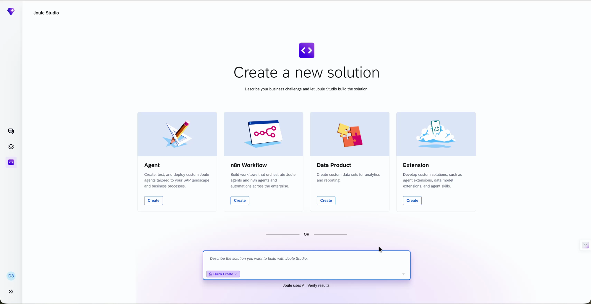

Do this:

1. Open Joule Studio with the URL and credentials provided for this workshop.
2. On the **Create a new solution** screen, find the **Data Product** tile ("Create custom data sets for analytics and reporting") and select **Create** on it.

✓ **Checkpoint** — The **Create a Data Product** dialog opens.

> **Note:** The screen also offers Agent, n8n Workflow and Extension tiles. For this exercise you only use **Data Product**.

---

### Step 2 — Name Your Solution and Describe the Business Need

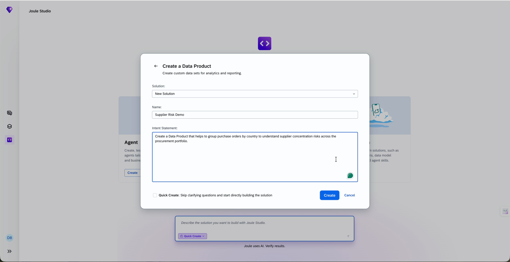

Do this:

1. Leave **Solution** on **New Solution**.
2. In **Name**, enter `Supplier Risk Demo`. Put your own name in front, for example `Alex Supplier Risk Demo`, so that you can find your solution later.
3. In **Intent Statement**, paste the text below exactly.

   ```
   Create a Data Product that helps to group purchase orders by country to understand supplier concentration risks across the procurement portfolio.
   ```
4. Leave **Quick Create** unchecked. It skips the clarifying questions, and you want to see them.
5. Select **Create**.

✓ **Checkpoint** — A new solution workspace opens, with the solution name at the top and a **Draft** tag next to it.

---

## Part 2 — From Business Intent to a Reviewable Requirement

### Step 3 — Let the Agent Start the Intent Analysis

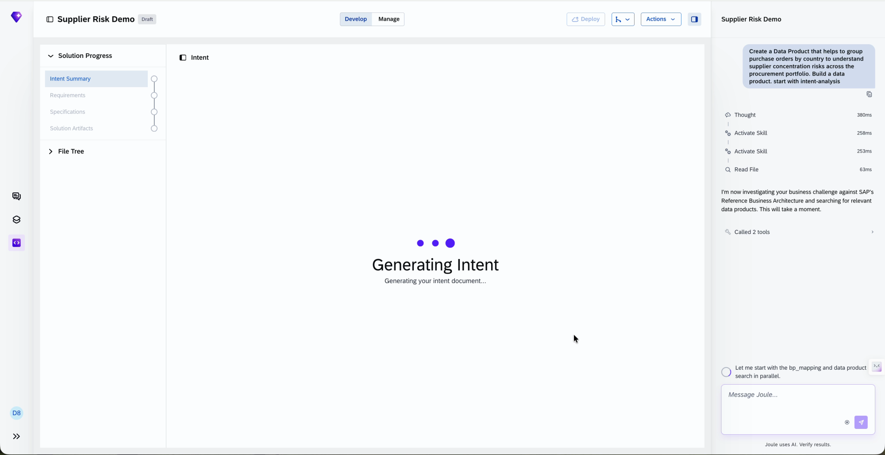

Do this:

1. Watch the workspace. The center shows **Generating Intent**. The **Solution Progress** list on the left shows four stages: **Intent Summary**, **Requirements**, **Specifications** and **Solution Artifacts**.
2. In the chat panel, read how the agent starts: it investigates your business challenge against SAP's Reference Business Architecture and searches for relevant data products.

✓ **Checkpoint** — The chat shows your intent statement, then the agent's first messages and the tool calls it makes.

> **Why this matters:** The agent starts from the business challenge and looks at what already exists. It does not start by building.

---

### Step 4 — Answer the Business Outcome Question

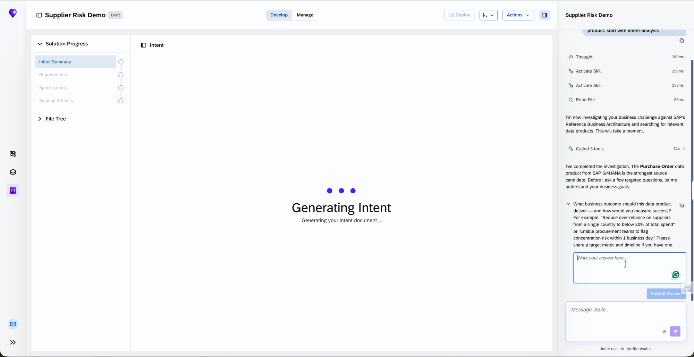

Do this:

1. Read the first question: *What business outcome should this data product deliver, and how would you measure success?*
2. In **Write your answer here**, type the text below.

   ```
   Reduce over-reliance on suppliers from a single country to below 30% of total spend
   ```
3. Select **Submit Answer**.

✓ **Checkpoint** — Your answer appears in the chat, and the agent asks the next question.

---

### Step 5 — Choose the Users and the Baseline

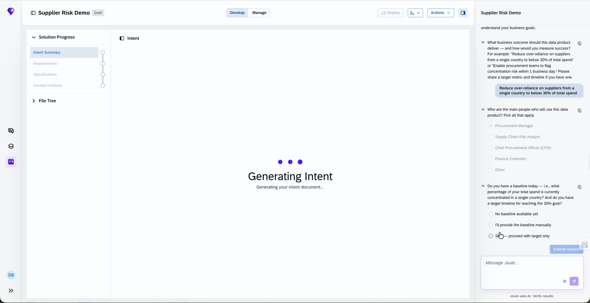

Do this:

1. For **Who are the main people who will use this data product? Pick all that apply**, select **Procurement Manager**.
2. For **Do you have a baseline today**, select **No baseline available yet**.
3. Select **Submit Answer**.

✓ **Checkpoint** — Both answers are accepted, and the agent reports what it found.

---

### Step 6 — Review the Source the Agent Found and Choose to Derive

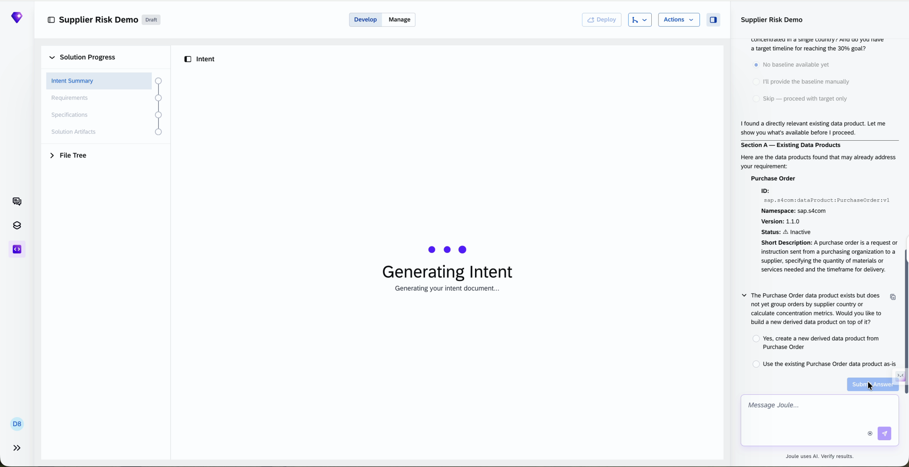

Do this:

1. Read the agent's finding. It shows the existing **Purchase Order** data product with its ID (`sap.s4com:dataProduct:PurchaseOrder:v1`), namespace, version and a short description.
2. Read the question: the Purchase Order data product does not yet group orders by supplier country or calculate concentration metrics.
3. Select **Yes, create a new derived data product from Purchase Order**, then **Submit Answer**.

✓ **Checkpoint** — The agent moves on to confirm the business goal.

> **Why this matters:** The agent searches and recommends. You decide whether to use the existing data product as it is or to build a new one on top of it.

---

### Step 7 — Confirm the Business Goal

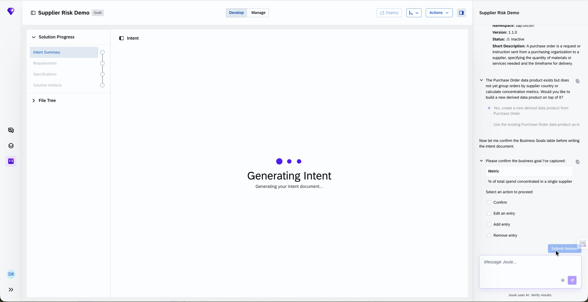

Do this:

1. Read the business goal table: the metric is the **percentage of total spend concentrated in a single supplier country**, the target is **below 30%**, and the capability is **Supplier Concentration Risk Management**.
2. Under **Select an action to proceed**, select **Confirm**, then **Submit Answer**. The other options let you edit, add or remove an entry.

✓ **Checkpoint** — The agent shows a full Intent Analysis Summary.

---

### Step 8 — Confirm the Intent Summary

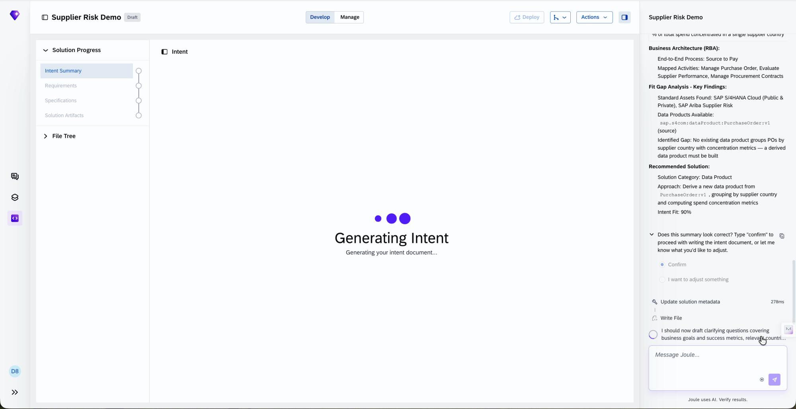

Do this:

1. Read the summary: business challenge, affected user role, business goals, the business architecture (**Source to Pay**), the fit-gap findings and the recommended solution.
2. Note the identified gap: no existing data product groups purchase orders by supplier country with concentration metrics, so a derived data product must be built.
3. Select **Confirm**, then **Submit Answer**.

✓ **Checkpoint** — The agent writes `intent.md`, and the **Intent Summary** stage gets a green check mark.

> **Why this matters:** The fit-gap analysis shows why a new data product is needed. The summary shows an **Intent Fit** of 90%.

---

### Step 9 — Review the Intent Document

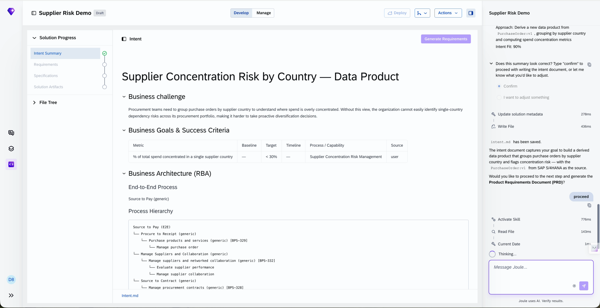

Do this:

1. Read the intent document in the center panel. It has **Business challenge**, **Business Goals & Success Criteria**, **Business Architecture (RBA)** and a **Process Hierarchy**.
2. The agent asks whether to proceed to the Product Requirements Document (PRD). In the message box, type `proceed` and send it.

✓ **Checkpoint** — The agent starts generating the requirements.

---

### Step 10 — Confirm the PRD Summary

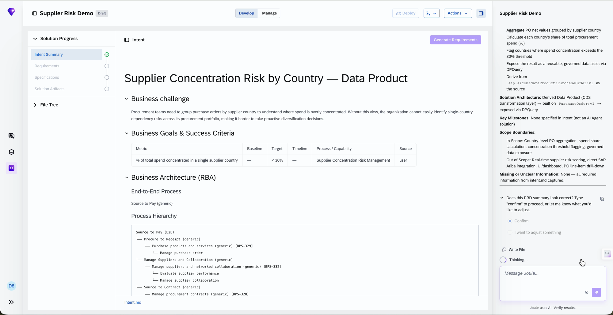

Do this:

1. Read the PRD summary in the chat: the transformation tasks (aggregate purchase order net values by supplier country, calculate each country's share of total spend, flag countries above the 30% threshold, expose the result through DPQuery), the solution architecture and the scope boundaries.
2. Select **Confirm**, then **Submit Answer**.

✓ **Checkpoint** — The agent saves `product-requirements-document.md`, and the **Requirements** stage gets a green check mark.

> **Why this matters:** Look at the **Out of Scope** list in the summary. The agent limits the work on purpose.

---

### Step 11 — Review the PRD and Move to the Build

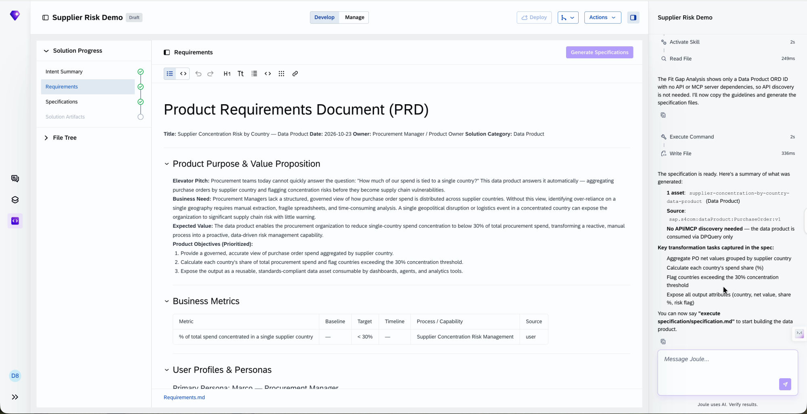

Do this:

1. Read the **Product Requirements Document (PRD)** in the center panel: **Product Purpose & Value Proposition**, **Business Metrics** and **User Profiles & Personas**.
2. The agent asks whether to proceed to the specification. Type `proceed` and send it.
3. When the agent reports that the specification is ready, read its summary: one asset, the source, the key transformation tasks, and the note that no API or MCP discovery is needed.
4. The agent tells you to say `execute specification/specification.md`. In the recording, the message sent is `execute`. Type `execute` and send it.

✓ **Checkpoint** — The **Specifications** stage gets a green check mark, and the agent starts building the data product.

> **Why this matters:** The PRD is a business document you can read and edit. The specification turns it into a technical checklist that drives the build.

---

## Part 3 — Decisions During the Build

### Step 12 — Approve the Proposed Properties

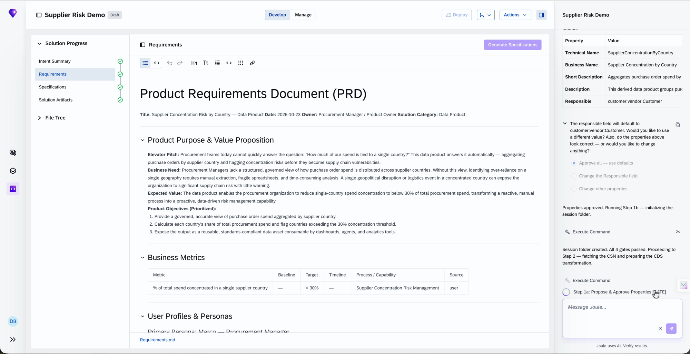

Do this:

1. Review the proposed properties: **Technical Name** (`SupplierConcentrationByCountry`), **Business Name** (Supplier Concentration by Country), **Short Description**, **Description** and **Responsible** (`customer:vendor:Customer`).
2. Select **Approve all — use defaults**, then **Submit Answer**. The other options let you change the Responsible field or other properties.

✓ **Checkpoint** — The agent confirms that the properties are approved, creates the session folder and fetches the schema it needs.

> **Why this matters:** You approve the name and description before the agent builds. To change only one property, use the matching change option instead of starting over.

---

### Step 13 — Make a Design Decision

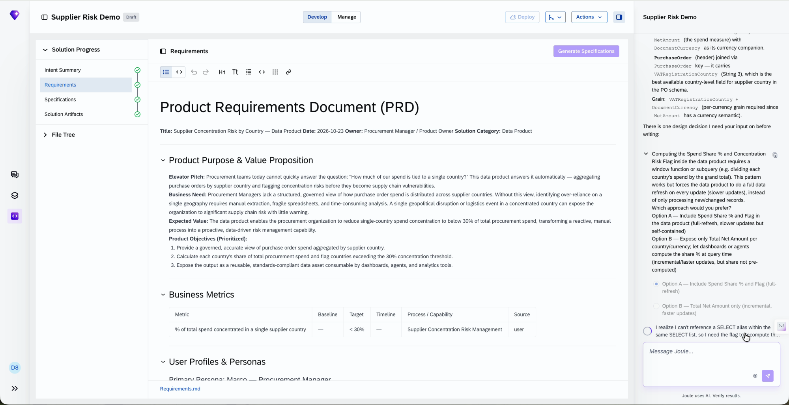

Do this:

1. Read the agent's schema findings. `NetAmount` is the spend measure, with `DocumentCurrency` as its currency. The country comes from `VATRegistrationCountry` on the purchase order header, which the agent names as the best available country-level field for supplier country in this schema.
2. Read the design decision: calculating the spend share and the concentration risk flag inside the data product means a full refresh on every update (slower updates, but self-contained). The alternative is to expose only the total net amount and let consumers calculate the share (faster updates, but the share is not pre-computed).
3. Select **Option A — Include Spend Share % and Flag (full-refresh)**, then **Submit Answer**.

✓ **Checkpoint** — The agent confirms **Option A (full-refresh)** and continues writing the transformation.

> **Why this matters:** You do not need to know the technical detail. The agent shows the trade-off, a complete metric against faster updates, and lets you decide.

---

### Step 14 — Choose What Gets Authorization Protection

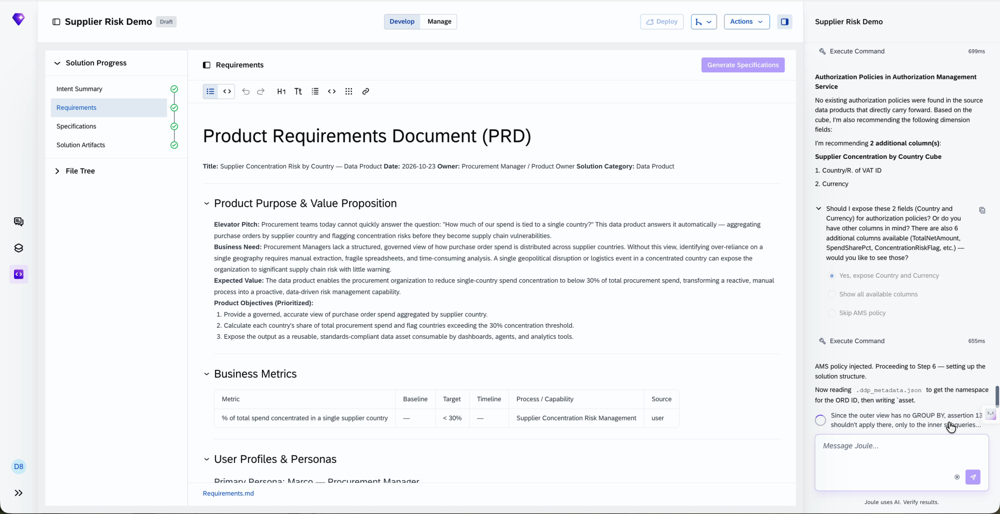

Do this:

1. Read the message from the agent: no existing authorization policies were found in the source data products that carry forward. The agent recommends two columns for authorization: **Country/R. of VAT ID** and **Currency**.
2. Select **Yes, expose Country and Currency**, then **Submit Answer**. The other options are **Show all available columns** and **Skip AMS policy**.

✓ **Checkpoint** — You see: *AMS policy injected. Proceeding to Step 6 — setting up the solution structure.*

> **Why this matters:** Authorization is part of the creation flow. The agent proposes which columns to protect, and you confirm.

---

## Part 4 — Review and Wrap-Up

### Step 15 — Preview the Data and Approve

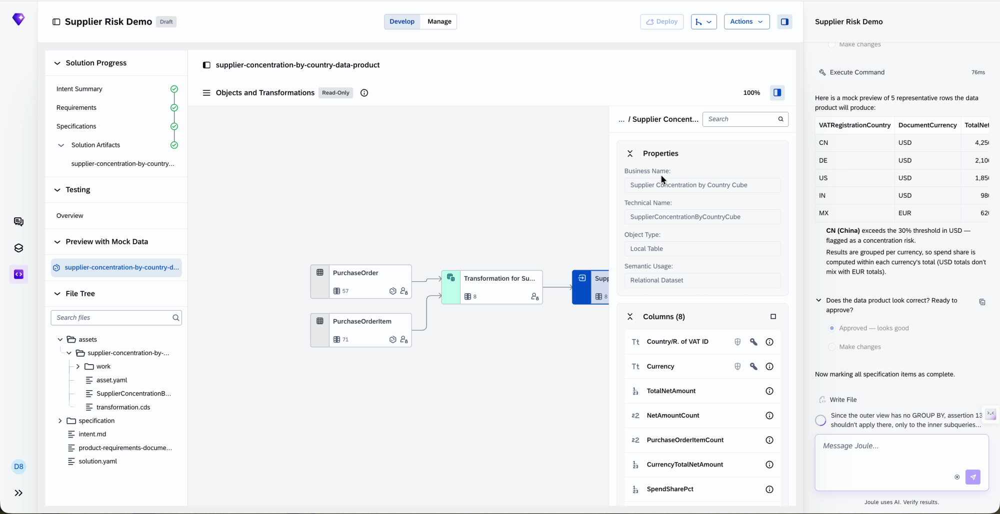

Do this:

1. When the agent asks whether to preview the data, make changes or approve, select **Preview the data**, then **Submit Answer**.
2. Read the preview: five representative rows (country and currency, with total net amounts). The agent flags **CN (China)** as exceeding the 30% threshold in USD and explains that spend share is calculated within each currency's total.
3. When the agent asks whether the data product looks correct, select **Approved — looks good**, then **Submit Answer**.

✓ **Checkpoint** — The agent marks all specification items as complete.

> **Note:** The preview is **mock data**. It is not live customer data.

> **Why this matters:** The preview lets you check that the result makes sense before anything is deployed.

---

### Step 16 — Look at the Transformation (Optional)

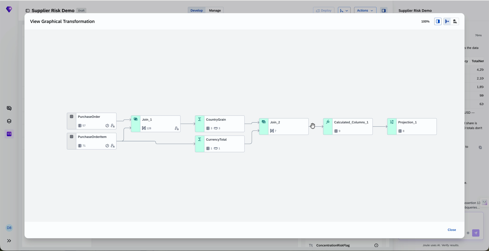

Do this:

1. In the **Objects and Transformations** view, select the transformation, then select **View Graphical Transformation**.
2. Follow the flow from left to right: **PurchaseOrder** and **PurchaseOrderItem** are joined, grouped into **CountryGrain** and **CurrencyTotal**, joined again, extended with calculated columns, and projected to the output.
3. Select **Close** when you have finished.

✓ **Checkpoint** — You have seen how the data product is built from the two source tables.

---

### Step 17 — Review the Finished Data Product

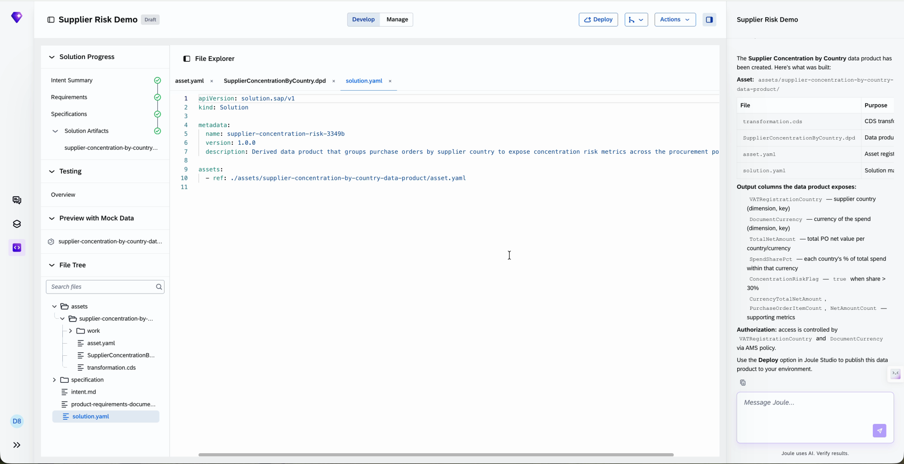

Do this:

1. Read the agent's summary of what was built: the asset, the files it generated (`transformation.cds`, `SupplierConcentrationByCountry.dpd`, `asset.yaml` and `solution.yaml`), the output columns, and the authorization setup.
2. In the file tree, open `solution.yaml` to see the solution definition.

✓ **Checkpoint** — You see the summary, and the **Deploy** button at the top is available.

> **Note:** **Do not click Deploy.** The agent points to Deploy as the next step. Deployment is not part of this exercise.

---

## Troubleshooting

The agent works live, so you may see something that differs from this guide or from the screenshots. Here is what to do.

| If you see... | What is happening | What to do |
| --- | --- | --- |
| **The agent asks slightly different questions, or words them differently, than this guide** | Expected. The agent's responses are generated live and can vary between runs. | Find the closest step in this guide and choose the option that matches the intent of that step. The flow, the decision points and the checkpoints stay the same. |
| **You are noticeably behind the group** | Each participant takes a different amount of time, depending on how many answers they read and change. | Use the checkpoints to see exactly where you are, and ask a facilitator for help. |

---

## Summary

You have completed Exercise 1. In this exercise you:

- Turned a two-sentence business requirement into a derived data product, without writing SQL or a schema by hand.
- Answered the agent's clarifying questions about outcome, users and baseline.
- Chose to derive a new data product from the Purchase Order data product the agent found.
- Confirmed the intent summary and the PRD, then started the build with the specification.
- Made one design decision (full refresh with spend share and risk flag) and chose which columns to protect with authorization.
- Reviewed a mock data preview and the generated transformation of the finished data product.

Continue to [Exercise 2](../ex2/README.md)
