# Exercise 1 — Supplier Concentration Risk by Country

In this exercise, you will use the Data Product Creation Agent to build a derived data product that groups purchase orders by supplier country. The agent will search for source data, handle a real schema gap, and ask you to make a trade-off decision — all with your approval at each step.

**What you will build:** A data product that joins Purchase Order and Supplier master data to help procurement teams identify supplier concentration risk by country.

**Time:** ~60 minutes

---

## Part 1 — Getting Started

### Step 1 — Confirm Access

Log in to Joule Studio and verify you can see the Solutions list.

1. Open the Joule Studio URL provided for this workshop and sign in with your assigned credentials.

✓ **Checkpoint** — You should see: the Joule Studio home screen with a **Solutions** list on the left and a **+ New** button.

---

### Step 2 — Start a New Data Product

1. Click **+ New**.
2. Select **Data Product** from the options presented.
<br>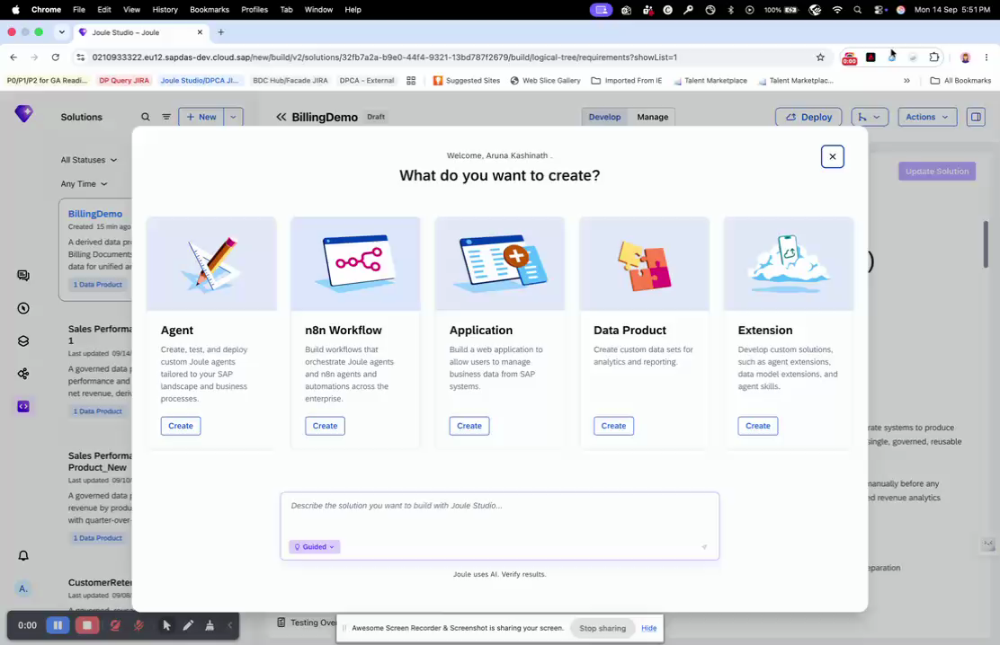

✓ **Checkpoint** — You should see: the **Create a Data Product** dialog.

---

### Step 3 — Name Your Solution and Enter the Intent Statement

1. In the **Name** field, enter your name followed by `Supplier Risk Demo` — for example: `Alex Supplier Risk Demo`. This makes your solution easy to find in the list later.
2. In the **Intent Statement** field, paste the following exactly:

> **Paste this:**
> ```
> Create a Data Product that helps to group purchase orders by country to understand supplier concentration risks across the procurement portfolio.
> ```

3. Leave **Quick Create** unchecked — you want the full guided experience with every decision point visible.
4. Click **Create**.
<br>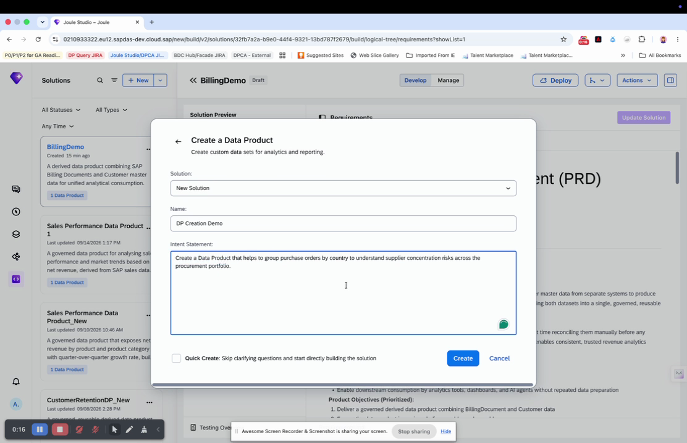

✓ **Checkpoint** — You should see: a new solution workspace opens, and your intent statement appears as the first message in the chat panel.

---

## Part 2 — From Intent to Requirements

### Step 4 — Source Discovery

The agent now searches for a matching source data product in your landscape.

1. Wait while the agent searches. Do not click anything.
<br>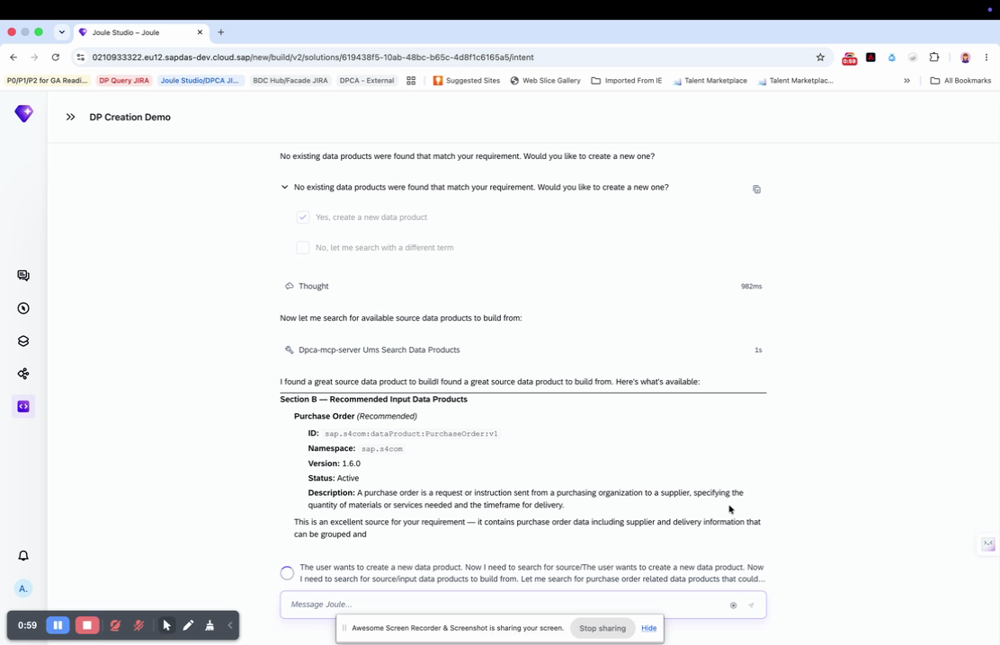

✓ **Checkpoint** — You should see: a recommendation for the **Purchase Order** data product (`sap.s4com:dataProduct:PurchaseOrder:v1`), with a description of why it fits your requirement.

> **If you see an error (e.g. a 502 error):** This is a known transient issue. The agent will retry automatically within a few seconds. Wait up to 30 seconds before raising your hand.

---

### Step 5 — Confirm the Source

1. Select the recommended **Purchase Order** data product to confirm it as your source.
<br>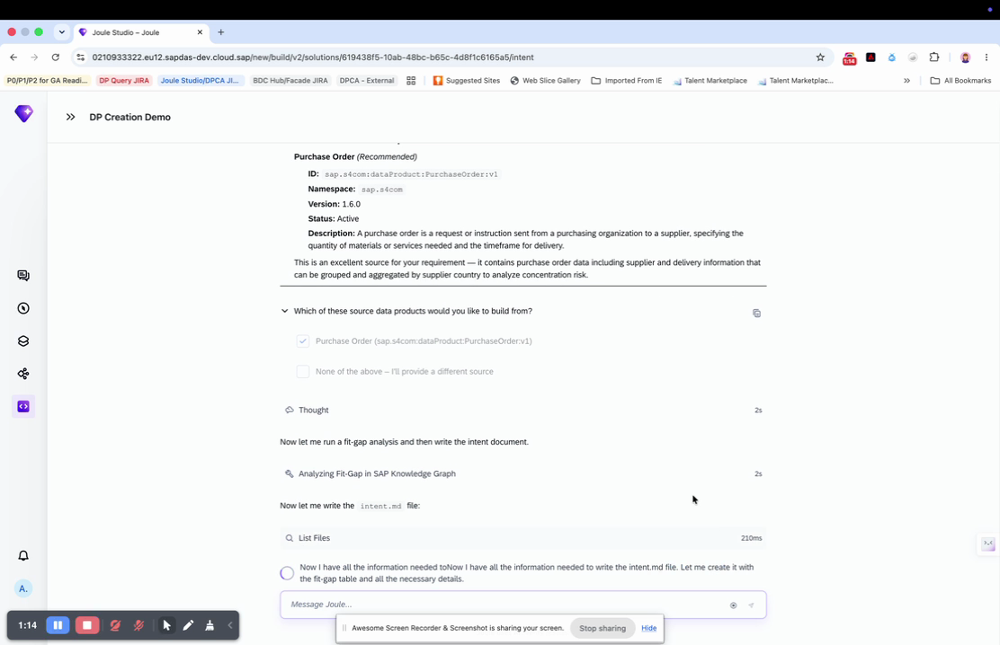

✓ **Checkpoint** — You should see: the agent proceeds to run a fit-gap analysis and begins writing the intent document.

---

### Step 6 — Choose the Guided Path

The agent offers two options for how to continue.

1. Click **Create Requirements File** — this keeps every clarifying step visible.
<br>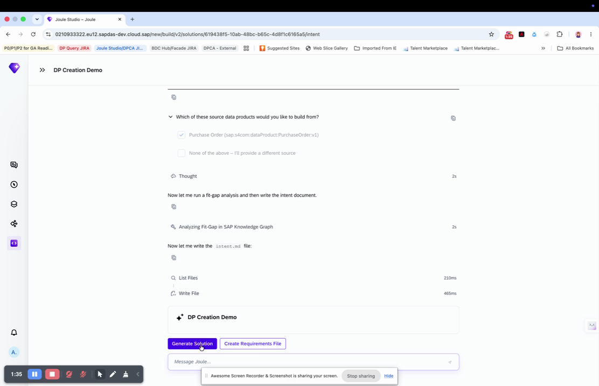

> **Note:** "Generate Solution" fast-tracks to the result with reasonable assumptions. Today you use the guided path so every decision point is visible.

✓ **Checkpoint** — You should see: the agent begins writing the requirements and the pipeline bar updates to show **Requirements** in progress.

---

### Step 7 — Review and Confirm the PRD

1. Read through the **personas** and **key requirements** in the right-hand panel. Look for the specific requirement about computing a concentration risk indicator (High / Medium / Low).
<br>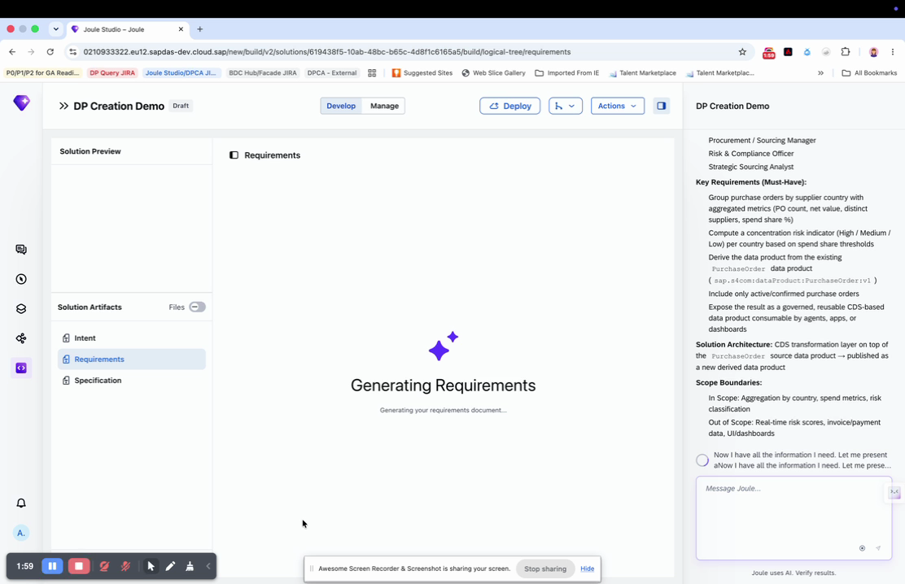

✓ **Checkpoint** — You should see: a list of personas (e.g. Procurement/Sourcing Manager, Risk & Compliance Officer), a **Key Requirements (Must-Have)** list, and explicit Scope Boundaries.

2. When prompted to review the PRD summary, select **Confirm — write the PRD** to proceed.
<br>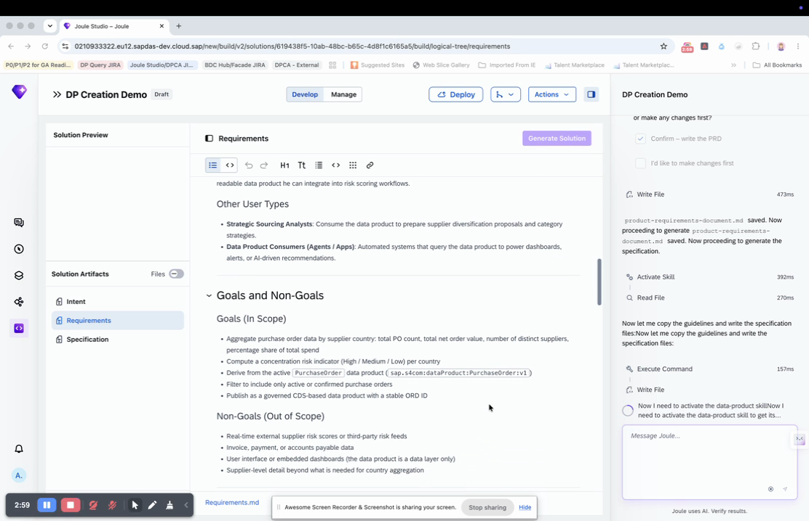

✓ **Checkpoint** — You should see: a complete PRD in the center panel, with sections for Product Purpose & Value Proposition, Goals (In Scope), and Non-Goals (Out of Scope).

---

## Part 3 — The Schema Gap

### Step 8 — Generate the Specification

1. Once you have reviewed the PRD, paste the following into the chat panel:

> **Paste this:**
> ```
> execute specification/specification.md
> ```

✓ **Checkpoint** — You should see: the pipeline bar at the top shows **Specification** actively in progress, and the chat panel begins listing execution steps.

---

### Step 9 — Approve the Proposed Name and Description

The agent proposes a Technical Name, Business Name, Short Description, and Description for your data product.

1. Review each field.
2. If they look correct, select **Approve**.
3. If you want to change just one field, use the specific **Change...** option for that field rather than starting over.
<br>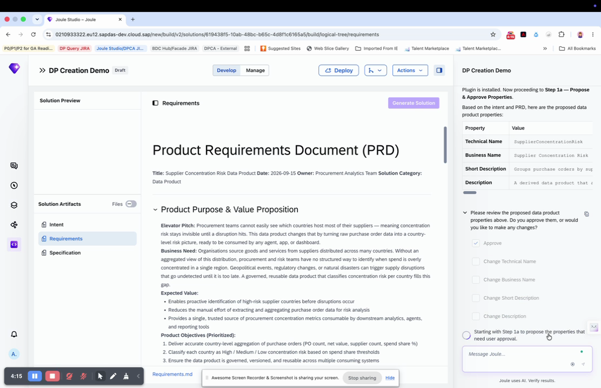

✓ **Checkpoint** — You should see: the agent continues to the next specification step after you approve.

---

### Step 10 — The Agent Finds a Real Gap

The agent has discovered that the Purchase Order data does not contain a usable supplier-country field — only a Supplier ID that references a separate data product.

1. Read the agent's explanation carefully.
<br>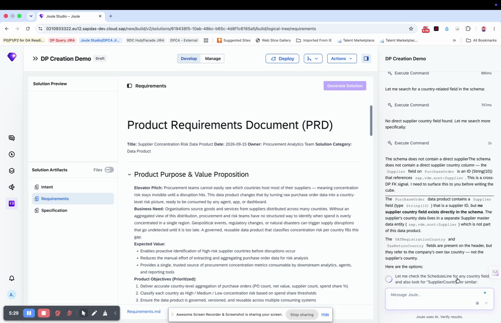

> **Why this matters:** The agent correctly avoided two fields that look relevant (`VATRegistrationCountry`, `TaxReturnCountry`) but actually describe the company's own tax country, not the supplier's country. This is the agent grounding its recommendation in what the data actually means.

2. Select the first option: **search for a Supplier master data product** to enrich the result with country data.
<br>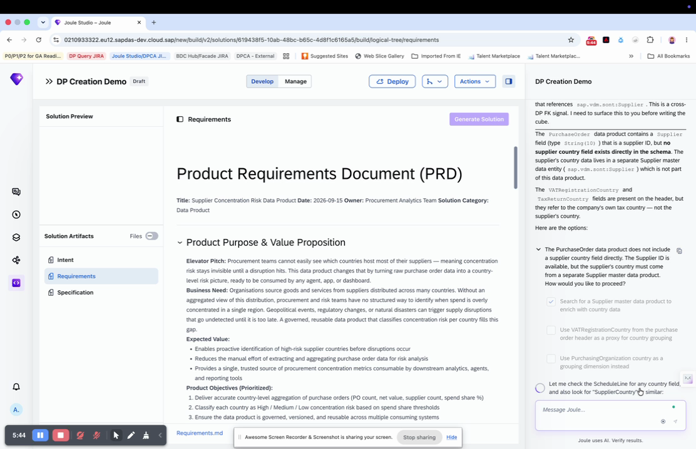

✓ **Checkpoint** — You should see: the agent finds a **Supplier** data product (`sap.s4com:dataProduct:Supplier:v1`), confirms it is the right match, and adds it as a second source.

---

### Step 11 — The Trade-Off Decision

Computing the full spend-share percentage requires a calculation that forces a full data recompute on every update, rather than processing only changed rows.

1. Read the explanation and the four options with their stated trade-offs.
<br>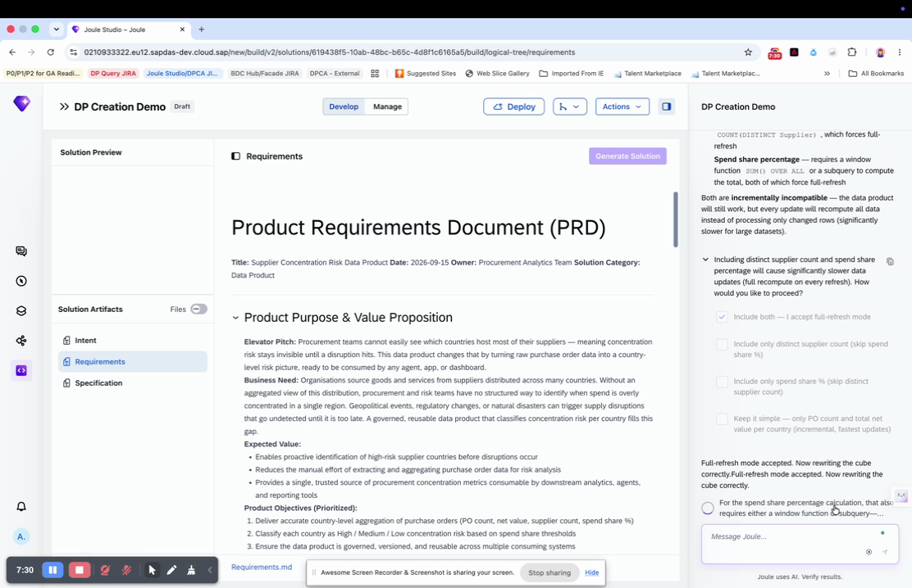

2. Choose **Include both — I accept full-refresh mode** to get the complete metric.

✓ **Checkpoint** — You should see: the agent records your decision and continues with the specification.

---

## Part 4 — Governance and Review

### Step 12 — Confirm Authorization

The agent recommends exposing `SupplierCountry` for row-level authorization.

1. Select **Yes, expose SupplierCountry for authorization**.
<br>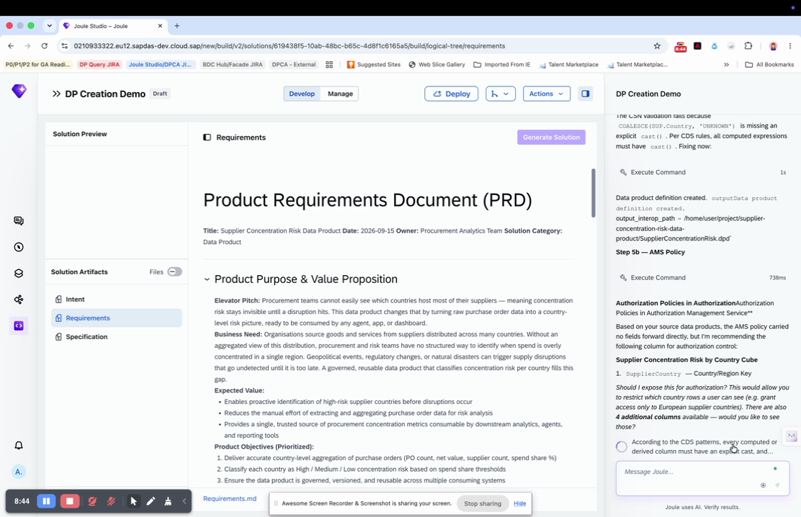

✓ **Checkpoint** — You should see: the message **"AMS policy injected. Proceeding to Step 6 — Setup Solution."**

---

### Step 13 — Review the Finished Data Product

The agent presents a plain-language summary of what was built: what is grouped, which attributes are included, what filter is applied, and what authorization policy is in place.

1. Read the summary.
2. Select **Preview the data** to see sample rows.
<br>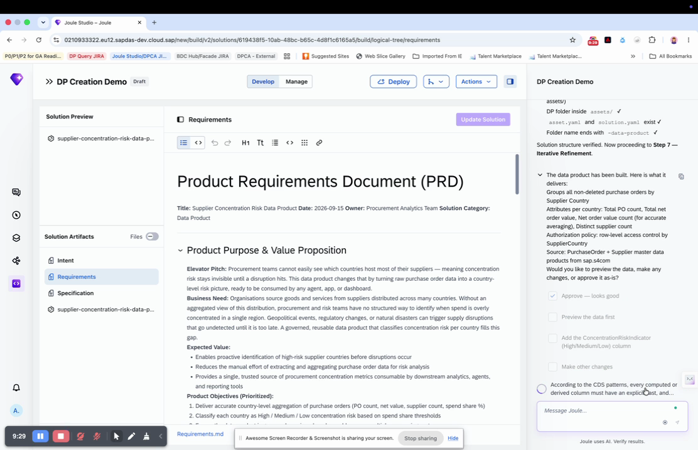

✓ **Checkpoint** — You should see: a table of sample rows, one per supplier country (e.g. DE, CN, US, IN), with purchase order counts and spend values.

> **Note:** This preview uses realistic mock data, not live customer data.

---

### Step 14 — Wrap Up

1. Once you are satisfied with the preview, select **Approve**.
2. **Do not click Deploy.** Testing and deployment are not demonstrated in this session.
<br>

✓ **Checkpoint** — You should see: your data product definition saved and listed in your Solutions view.

---

## Summary

You have completed Exercise 1. You used the Data Product Creation Agent to:

- Turn a two-sentence business requirement into a fully governed data product definition
- Confirm a source data product recommended by the agent
- Resolve a real schema gap by adding a second source
- Make an explicit trade-off decision about performance vs. completeness
- Apply an authorization policy with a single confirmation

Continue to [Exercise 2 — Active Cost Centers for India](../ex2/README.md)
