# Exercise 1 — Supplier Concentration Risk by Country

In this exercise you will use the Data Product Creation Agent in Joule Studio to create a derived data product that groups purchase orders by supplier country. The agent guides you through the flow **Intent → Requirements → Specification → Solution**. You make the key decisions; the agent does the rest.

**What you will build:** A derived data product that joins Purchase Order and Supplier master data, to help procurement teams identify supplier concentration risk by country.

**Time:** ~45 minutes

**What you will learn:**
- How the agent turns a plain-language business requirement into a reviewable data product definition, without writing SQL or a schema by hand.
- How the agent handles a genuine data gap: it asks you for a decision instead of guessing.
- How the agent surfaces a real technical trade-off and lets you choose.
- How personal data and authorization are handled as part of data product creation.
- What you can do today (create and inspect a data product), and what comes later (testing and deployment).

> **Good to know:** The agent is an AI, so its wording, the order of its messages, and sometimes the names of the data products it proposes can differ slightly from the screenshots in this guide. The flow and the decision points stay the same. If something looks different or goes wrong, see [Troubleshooting](#troubleshooting) at the end of this exercise.

Each step has a **checkpoint**: something specific you should see before you move on. Use the checkpoints to find out early if you have fallen behind.

---

## Part 1 — Getting Started

### Step 1 — Confirm Access

1. Log in to Joule Studio with the URL and credentials provided for this workshop.
2. Confirm that you can see the **Solutions** list.

✓ **Checkpoint** — You see the Joule Studio home screen, with a **Solutions** list on the left and a **+ New** button to start a new solution. If you cannot log in, raise your hand now, before you continue.

---

### Step 2 — Start a New Data Product

Click **+ New**, then select **Data Product** from the options.

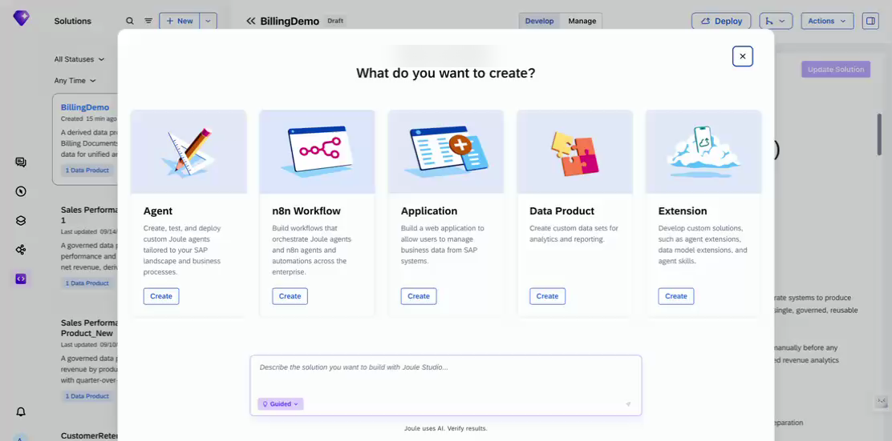

---

### Step 3 — Name Your Solution and Describe the Business Need

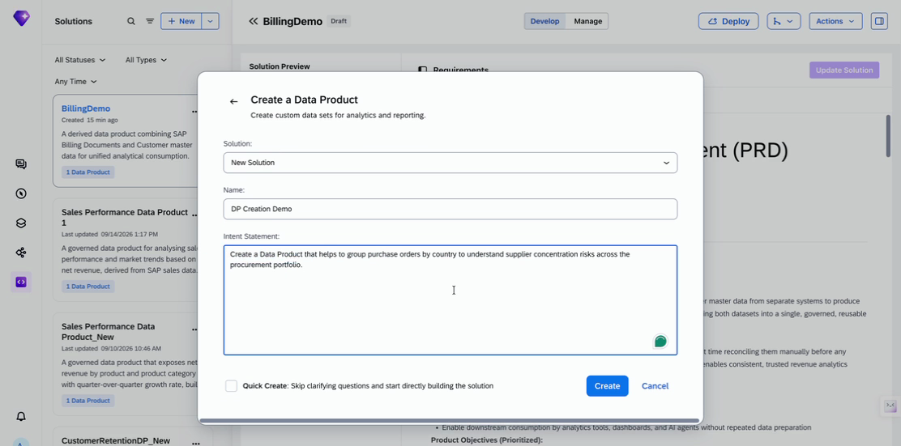

1. In the **Name** field, enter a name for your solution. Use your own name plus `Supplier Risk Demo`, for example `Alex Supplier Risk Demo`, so that you can find it in the list later.
2. In the **Intent Statement** field, paste the following exactly:

> ```
> Create a Data Product that helps to group purchase orders by country to understand supplier concentration risks across the procurement portfolio.
> ```

3. Leave **Quick Create** unchecked. This gives you the full guided experience, with every clarifying question and approval step visible.
4. Click **Create**.

✓ **Checkpoint** — A new solution workspace opens, and your intent statement appears as the first message in the chat panel.

---

## Part 2 — From Business Intent to a Reviewable Requirement

### Step 4 — Let the Agent Search for a Source

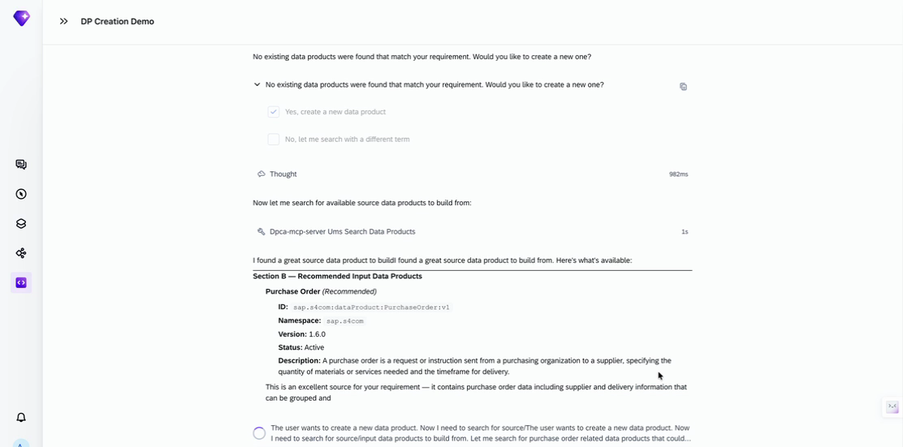

Wait while the agent searches for a matching source data product. It comes back with a specific recommendation, including the exact ID, the version, and a description of what the data product contains.

✓ **Checkpoint** — You see a recommendation for the Purchase Order data product (`sap.s4com:dataProduct:PurchaseOrder:v1`), with a description that explains why it fits your requirement.

---

### Step 5 — Confirm the Source

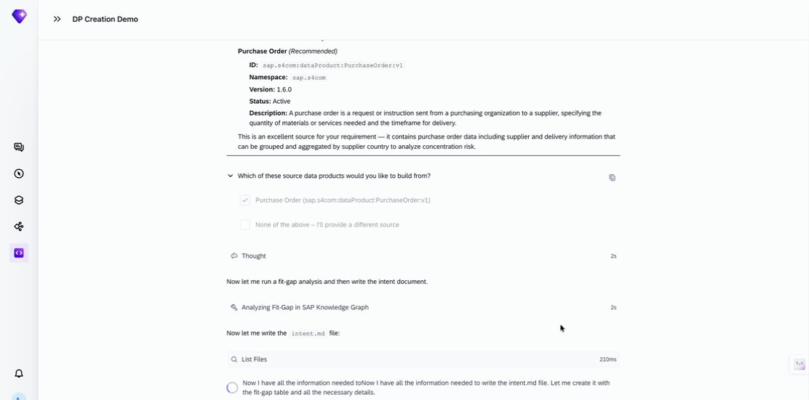

Select the recommended **Purchase Order** data product to confirm it as your source.

✓ **Checkpoint** — The agent runs a fit-gap analysis and begins writing the intent document.

> **Why this matters:** The agent searches and recommends, but you confirm or correct the source. It does not decide for you.

---

### Step 6 — Choose to Build Out the Full Requirements

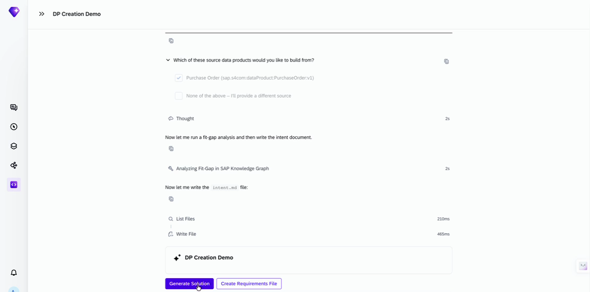

The agent offers two choices: **Generate Solution** (skip ahead) or **Create Requirements File** (continue guided). Click **Create Requirements File**.

> **Why this matters:** The fast-track path skips ahead with reasonable assumptions. The guided path stops for your confirmation at each meaningful decision. In this exercise you follow the guided path.

---

### Step 7 — Review the Generated Requirements

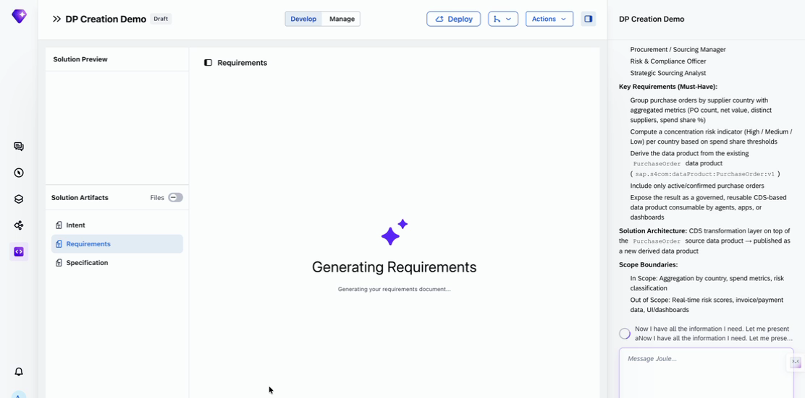

1. Read the personas and the key requirements that the agent generated in the right-hand panel. Notice the numbered requirement about computing a concentration risk indicator (High / Medium / Low) based on spend share thresholds.

✓ **Checkpoint** — You see a list of personas (for example Procurement / Sourcing Manager and Risk & Compliance Officer) and a **Key Requirements (Must-Have)** list, followed by explicit **Scope Boundaries**.

2. When the agent asks you to review the PRD summary, select **Confirm — write the PRD**.

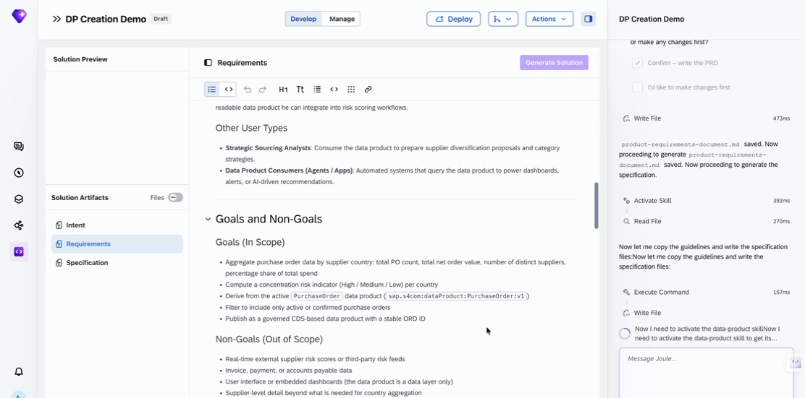

✓ **Checkpoint** — A complete Product Requirements Document (PRD) opens in the center panel, with sections for **Product Purpose & Value Proposition**, **Goals (In Scope)** and **Non-Goals (Out of Scope)**.

> **Why this matters:** Look at the Non-Goals section. It shows how the agent limits the work on purpose, instead of trying to do everything.

---

## Part 3 — Where It Gets Interesting: A Real Data Gap

### Step 8 — Generate the Specification

Once you have reviewed the PRD, generate the specification. The agent prompts you, or you can type `execute specification/specification.md` as instructed on screen.

✓ **Checkpoint** — The pipeline bar at the top shows **Specification** in progress, and the chat panel begins listing execution steps (installing a plugin, proposing properties, and so on).

---

### Step 9 — Approve the Proposed Name and Description

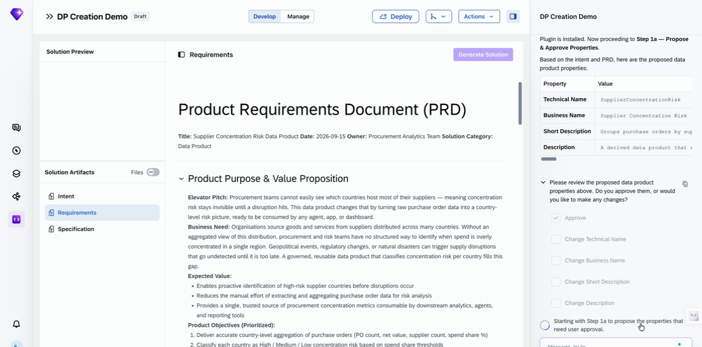

Review the proposed **Technical Name**, **Business Name**, **Short Description** and **Description**. If they look good, select **Approve**. To adjust only one field, use the specific **Change...** option for that field instead of starting over.

---

### Step 10 — The Agent Finds a Real Gap

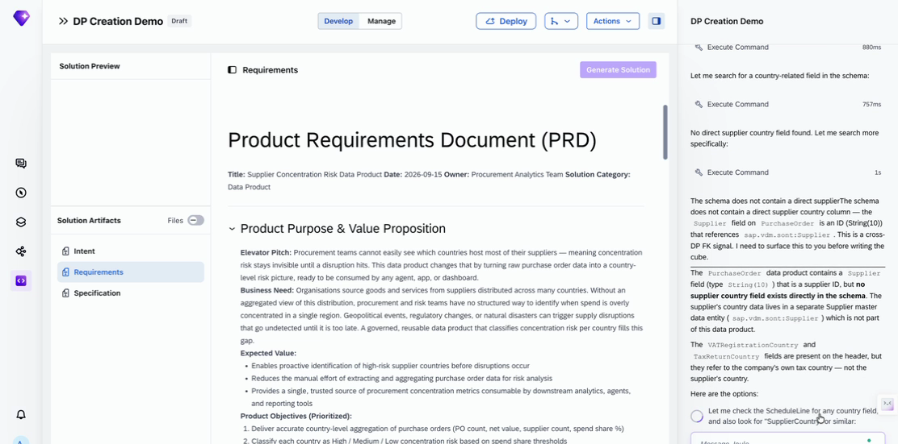

Read the agent's explanation carefully. It found that the Purchase Order data does not contain a usable supplier country field directly. It only contains a Supplier ID that points to a separate data product.

> **Why this matters:** Take a moment here. What would happen if the agent had just guessed? It correctly avoided two fields that look relevant, `VATRegistrationCountry` and `TaxReturnCountry`. They describe the company's own tax country, not the supplier's country. This is why grounding matters: the agent tells you what is missing instead of picking a plausible-looking field.

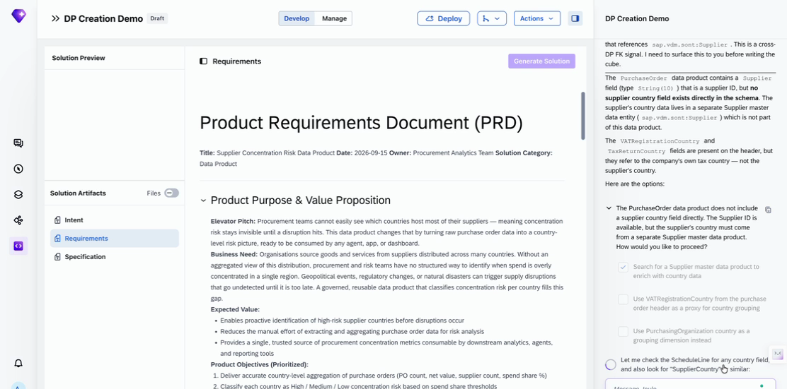

Select the first option: search for a Supplier master data product to enrich the result with country data.

✓ **Checkpoint** — The agent searches, finds a Supplier data product (`sap.s4com:dataProduct:Supplier:v1`), confirms that it is exactly what is needed, and adds it as a second source.

---

### Step 11 — A Genuine Trade-Off: Your Choice

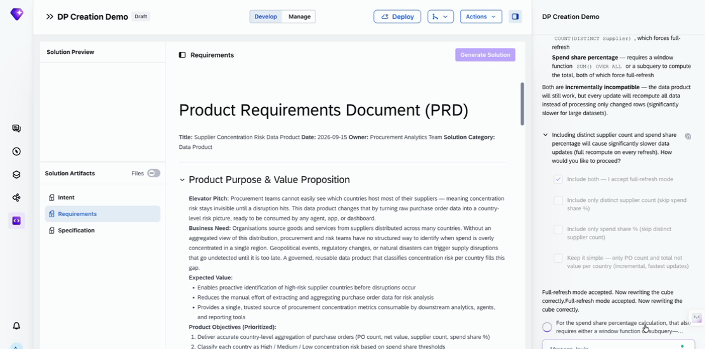

Read the explanation. Computing the full spend-share percentage needs a calculation that forces a full data recompute on every update, instead of processing only the changed rows. Choose **Include both — I accept full-refresh mode** to get the complete metric.

> **Why this matters:** You do not need to understand the technical detail behind the limitation. The point is that the agent shows you the trade-off, a complete metric against faster updates, and lets you decide.

---

## Part 4 — Governance, Completion, and What's Next

### Step 12 — Authorization: Confirm What Gets Protected

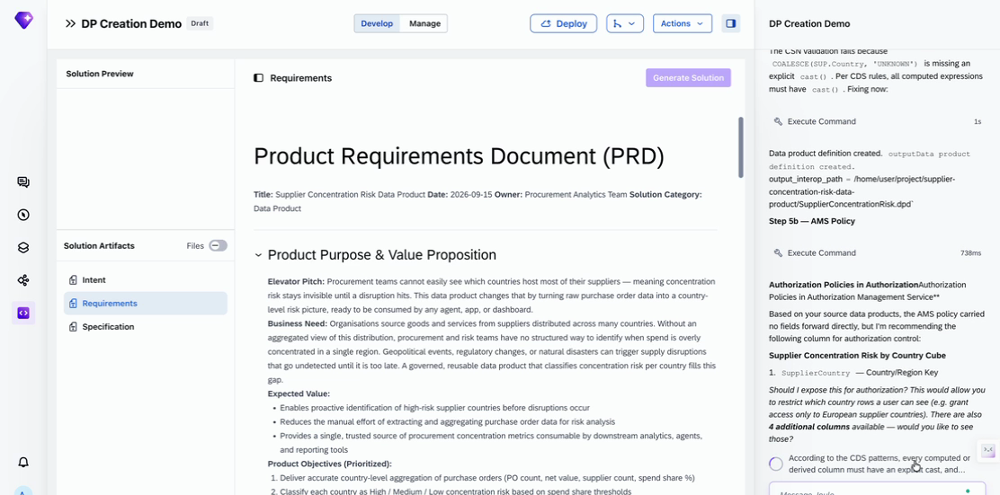

Select **Yes, expose SupplierCountry for authorization** when the agent asks.

✓ **Checkpoint** — You see: *AMS policy injected. Proceeding to Step 6 — Setup Solution.*

---

### Step 13 — Review the Finished Data Product

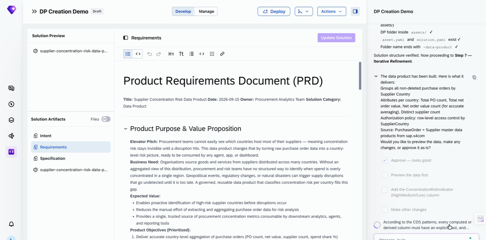

Read the summary: what is grouped, which attributes are included, which filter is applied, and which authorization policy is in place. Then choose **Preview the data**.

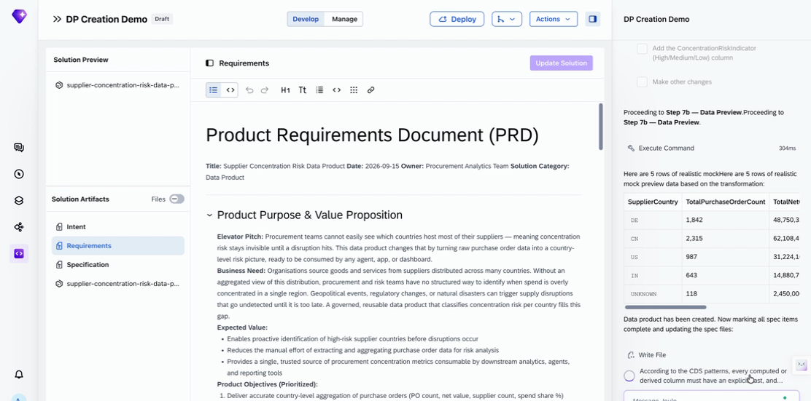

✓ **Checkpoint** — You see a table of sample rows, one per supplier country (for example DE, CN, US, IN), with purchase order counts and spend values.

> **Note:** The preview uses realistic **mock data**. It is not live customer data.

---

### Step 14 — Wrap-Up

When you are satisfied with the preview, select **Approve**.

> **Do not click Deploy.** Testing and deployment are outside the scope of this workshop. The interface shows Deploy as the next step because that is where the flow is heading. It is not part of this exercise.

---

## Troubleshooting

The agent works live, so you may see something that differs from this guide or from the screenshots. Here is what to do.

| If you see... | What is happening | What to do |
| --- | --- | --- |
| **The agent recommends a different source data product name, or asks slightly different questions** than the ones in this guide | Expected. The agent's responses are generated live and can vary between runs and between tenants. | Find the closest step in this guide and choose the option that matches the intent of that step. The overall flow, the decision points and the checkpoints stay the same. |
| **You are noticeably behind the group** | Each participant takes a different amount of time, depending on how many changes they ask the agent to make. | Use the checkpoints to see exactly where you are, and ask a facilitator for help. A facilitator may suggest the **Generate Solution** shortcut so that you can catch up. |

---

## Summary

You have completed Exercise 1. In this exercise you:

- Turned a two-sentence business requirement into a derived data product, without writing SQL or a schema by hand.
- Confirmed a source that the agent found, instead of letting it decide.
- Reviewed the requirements (PRD) and the specification that the agent generated.
- Saw the agent surface a real data gap and ask you for a decision, instead of guessing.
- Made one trade-off decision and confirmed which column to protect with authorization.
- Reviewed a plain-language summary and a mock data preview of the finished data product.

Continue to [Exercise 2](../ex2/README.md)
