# Exercise 1 — Supplier Concentration Risk by Country

In this exercise you will use Joule Studio to create a derived data product that groups purchase orders by supplier country. The agent guides you through five phases: **Prompt → Intent → Requirements → Specifications → Solution**. You make one key input per phase; the agent handles the rest.

**What you will build:** A data product that joins Purchase Order and Business Partner data to help procurement teams identify supplier concentration risk by country.

**Time:** ~30 minutes

---

## Phase 1 — Prompt

### Step 1 — Open Joule Studio and Start a New Data Product

1. Open the Joule Studio URL provided for this workshop and sign in with your assigned credentials.
2. On the home screen, click **Create Data Product**.

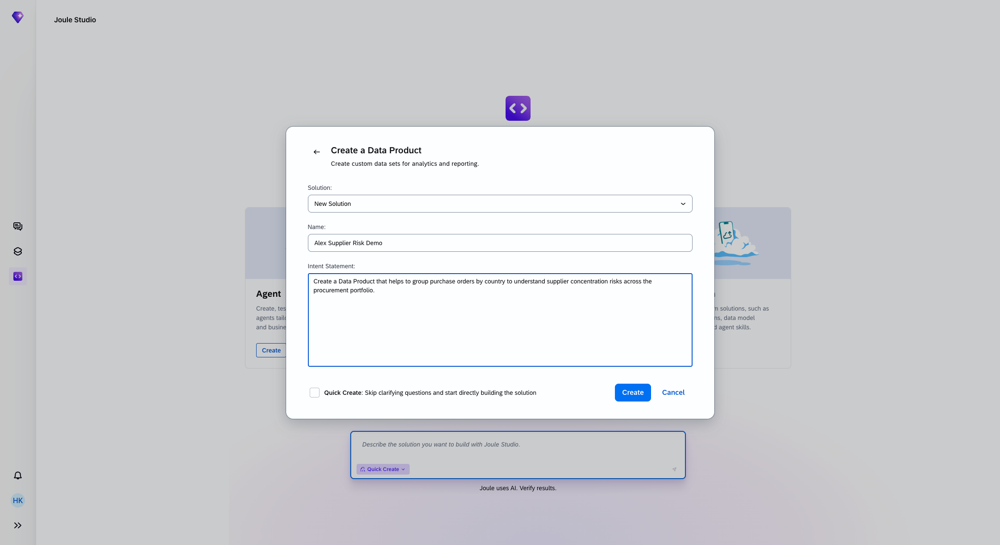

A dialog appears with three fields: **Solution**, **Name**, and **Intent Statement**.

---

### Step 2 — Fill in the Prompt

1. In the **Name** field, enter your first name followed by `Supplier Risk Demo` — for example: `Alex Supplier Risk Demo`. This makes your solution easy to find later.
2. In the **Intent Statement** field, paste the following exactly:

> ```
> Create a Data Product that helps to group purchase orders by country to understand supplier concentration risks across the procurement portfolio.
> ```

3. Leave **Quick Create** unchecked — this keeps every decision point visible.
4. Click **Create**.

✓ **Checkpoint** — A new solution workspace opens and your intent statement appears as the first message in the chat panel.

---

## Phase 2 — Intent

The agent now investigates your landscape before asking any questions.

### Step 3 — Watch the Agent Discover Sources

The agent automatically runs discovery queries in parallel. No input needed here.

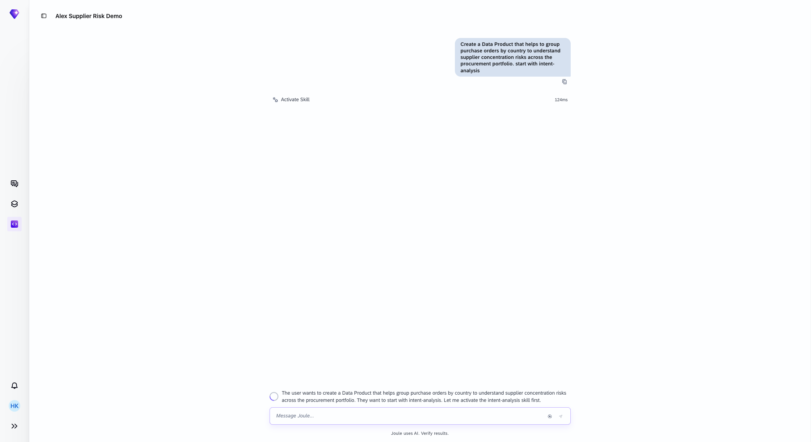

After a few seconds the agent reports what it found: an active **Purchase Order** data product and an active **Business Partner** data product — both are candidates as source inputs. It then asks you one focused question.

---

### Step 4 — Answer the Clarifying Question

The agent asks: **"Who will primarily use this data product, and what decisions will they make with it?"**

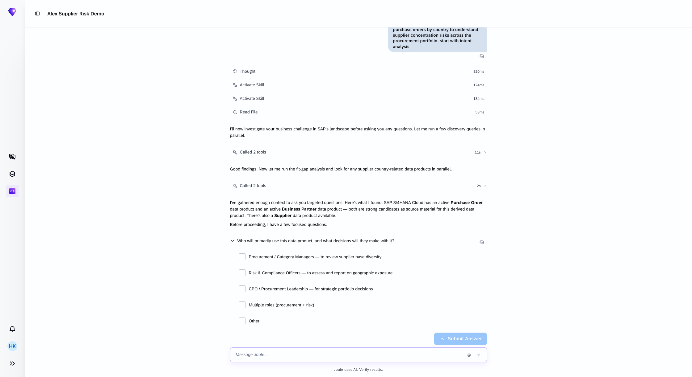

1. Select **Procurement / Category Managers — to review supplier base diversity**.

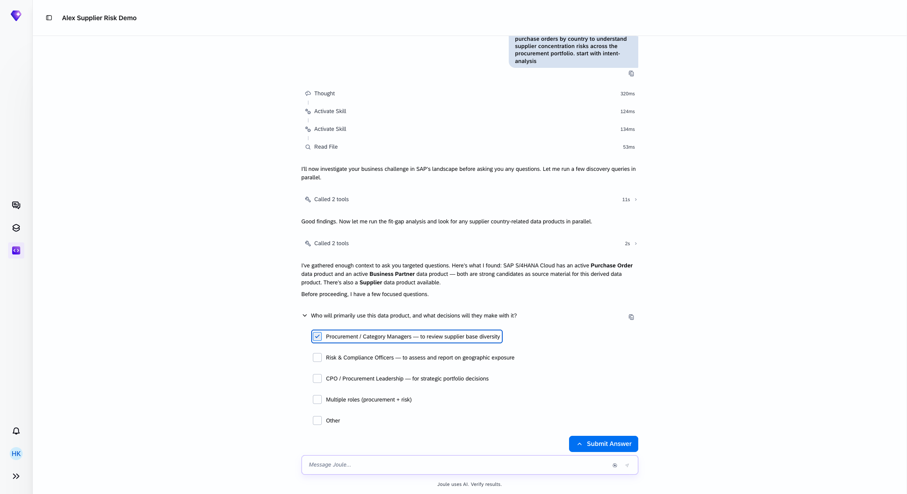

2. Click **Submit Answer**.

The agent automatically answers the remaining questions (country dimension, metrics, business outcome, concentration threshold) and assembles a complete **Intent Analysis Summary**.

---

### Step 5 — Confirm the Intent Summary

The agent presents a summary including:
- Business Challenge
- Primary Users
- Business Goals & Success Criteria (with a 30% concentration threshold)
- Business Architecture (Source to Pay E2E)
- Fit-Gap Analysis (PurchaseOrder:v1 + BusinessPartner:v1 as sources; custom derived product needed)
- **Intent Fit: 95%**

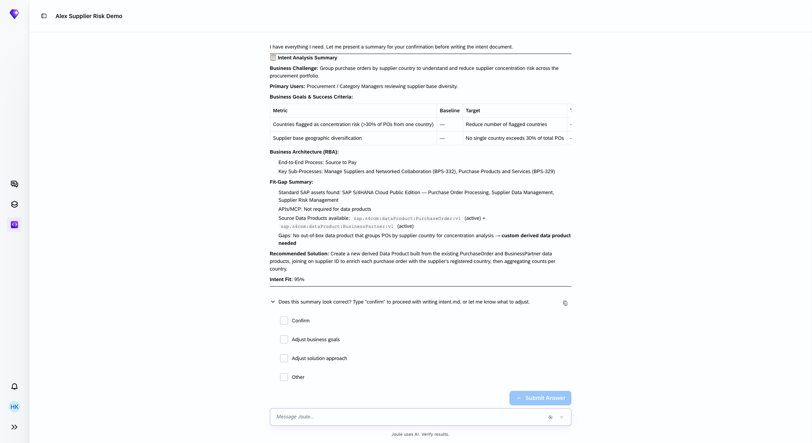

The first option **Confirm** is already selected. Click **Submit Answer**.

The agent writes `intent.md` and the center panel opens the completed intent document.

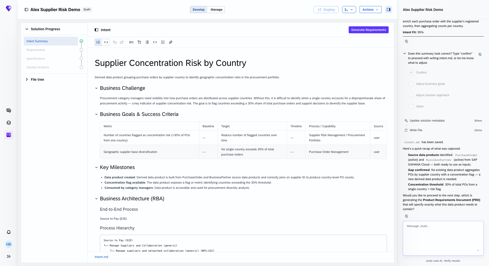

✓ **Checkpoint** — The **Intent Summary** step in the Solution Progress bar shows a green checkmark.

---

## Phase 3 — Requirements

### Step 6 — Generate the PRD

Click **Generate Requirements** in the top-right corner of the center panel.

The agent reads the intent, drafts a requirements summary, auto-confirms, and writes `product-requirements-document.md`.

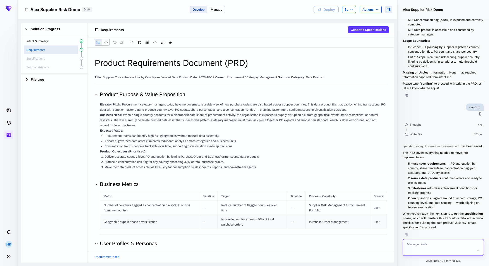

The PRD includes:
- **Product Purpose & Value Proposition** with elevator pitch and product objectives
- **Business Metrics** table (concentration risk threshold, geographic diversification target)
- **User Profiles & Personas**
- **5 must-have requirements**: PO aggregation by country, share percentage, concentration flag, join accuracy, DPQuery access
- **Scope Boundaries**: in scope and out of scope items

✓ **Checkpoint** — The **Requirements** step in the Solution Progress bar shows a green checkmark.

---

## Phase 4 — Specifications

### Step 7 — Generate the Specification

Click **Generate Specifications** in the top-right corner.

The agent reads the PRD and writes a `specification.md` with a 2-step build plan.

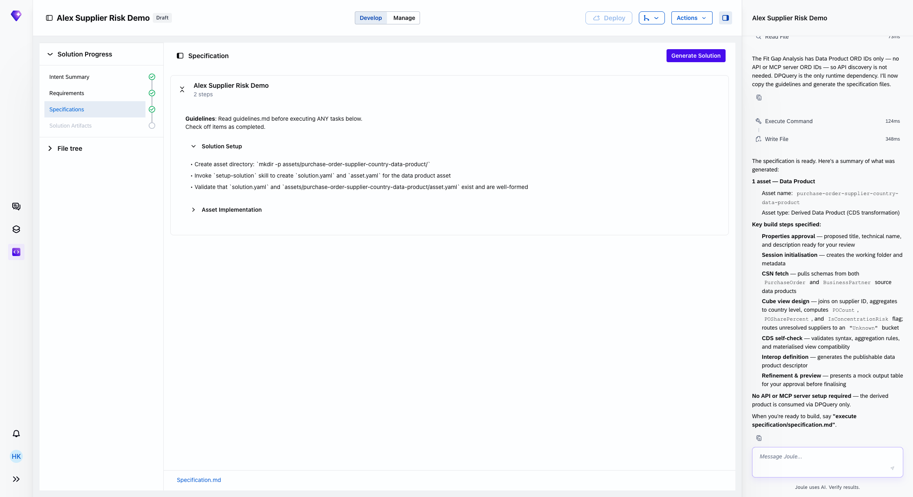

The specification defines:
- **Step 1 — Solution Setup**: create asset directory, invoke `setup-solution` skill, validate files
- **Step 2 — Asset Implementation**: CDS transformation, interop definition, AMS policy

✓ **Checkpoint** — The **Specifications** step in the Solution Progress bar shows a green checkmark.

---

## Phase 5 — Solution

### Step 8 — Generate the Solution

Click **Generate Solution** in the top-right corner or just type **execute specification/specification.md**. The agent begins executing the specification step by step.

---

### Step 9 — Approve the Data Product Metadata

The agent proposes a technical name, business name, and description for your data product.

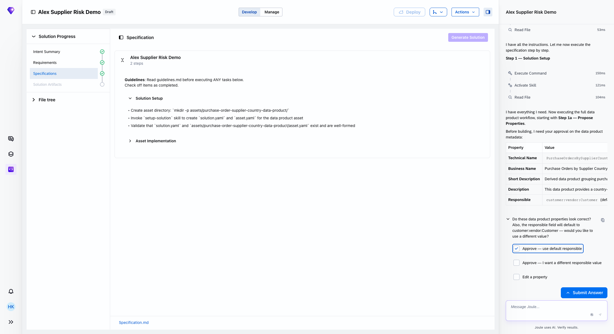

The first option **Approve — use default responsible** is already selected. Click **Submit Answer**.

---

### Step 10 — The Trade-Off Decision

The agent discovers that computing `POSharePercent` and `IsConcentrationRisk` requires a **window function**, which forces a full data refresh on every update rather than incremental processing.

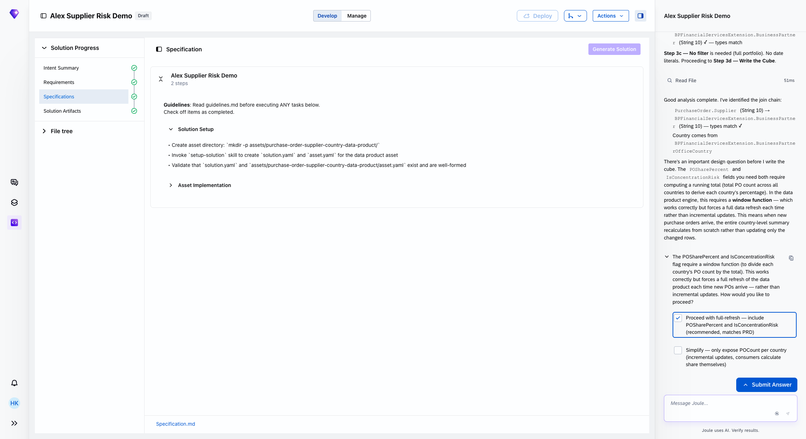

The first option — **Proceed with full-refresh — include POSharePercent and IsConcentrationRisk (recommended, matches PRD)** — is already selected. Click **Submit Answer**.

> **Why this matters:** The agent is surfacing a real technical trade-off: completeness of the metric vs. update performance. Choosing full-refresh means the concentration flag is always accurate; choosing incremental means faster updates but consumers must calculate the share themselves.

---

### Step 11 — Review the Mock Data Preview

The agent completes the build and presents a mock data preview showing what the data product returns:

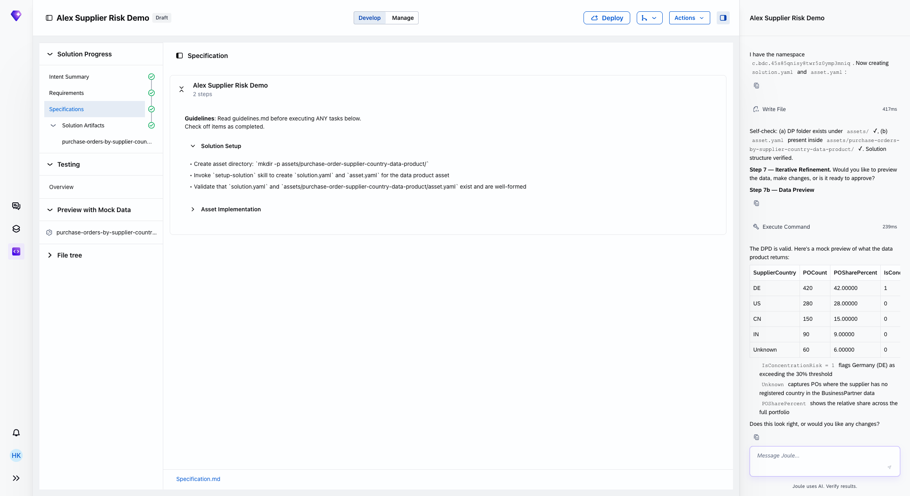

Verify the output looks correct:
- One row per `SupplierCountry`
- `POCount` and `POSharePercent` per country
- `IsConcentrationRisk = 1` for any country exceeding 30% (DE in this example)
- `Unknown` bucket for POs where the supplier has no registered country

Type **`looks good, approve`** in the message box and press Enter.

---

### Step 12 — Inspect the Completed Data Product

The agent finalises the build and the center panel switches to the data product diagram view.

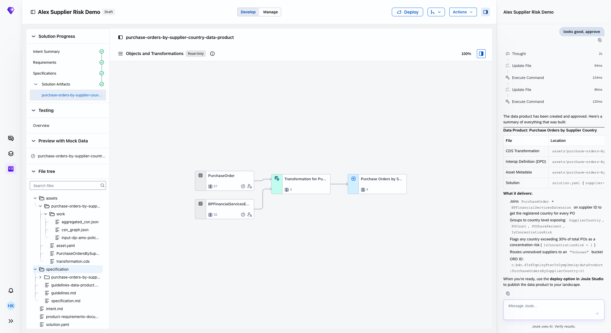

The file tree on the left confirms all artifacts were written:
- `transformation.cds` — CDS cube joining PurchaseOrder + BPFinancialServicesExtension
- `asset.yaml` — interop definition (DPD)
- `solution.yaml` — solution metadata
- `specification.md`, `intent.md`, `product-requirements-document.md` — the full design trail

✓ **Checkpoint** — All four steps in the Solution Progress bar show green checkmarks: Intent Summary, Requirements, Specifications, Solution Artifacts.

> **Do not click Deploy.** Testing and deployment are covered in a later exercise.

---

## Summary

You have completed Exercise 1. Following the **Prompt → Intent → Requirements → Specifications → Solution** flow, you:

- Entered a two-sentence business requirement as the prompt
- Answered one clarifying question: selected **Procurement / Category Managers** as the primary users; the agent completed intent analysis and wrote `intent.md`
- Generated a full PRD from the intent document
- Generated a build specification from the PRD
- Approved metadata, made one trade-off decision, and reviewed a mock data preview
- Produced a fully governed derived data product joining Purchase Order and Business Partner data

Continue to [Exercise 2](../ex2/README.md)
