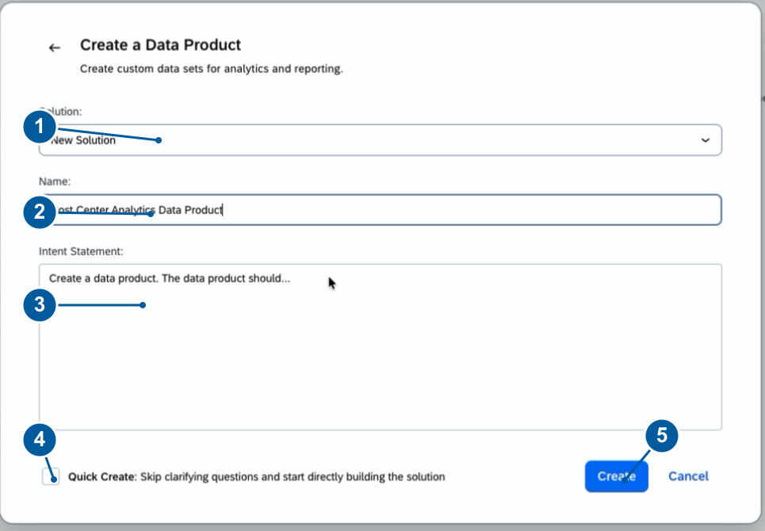
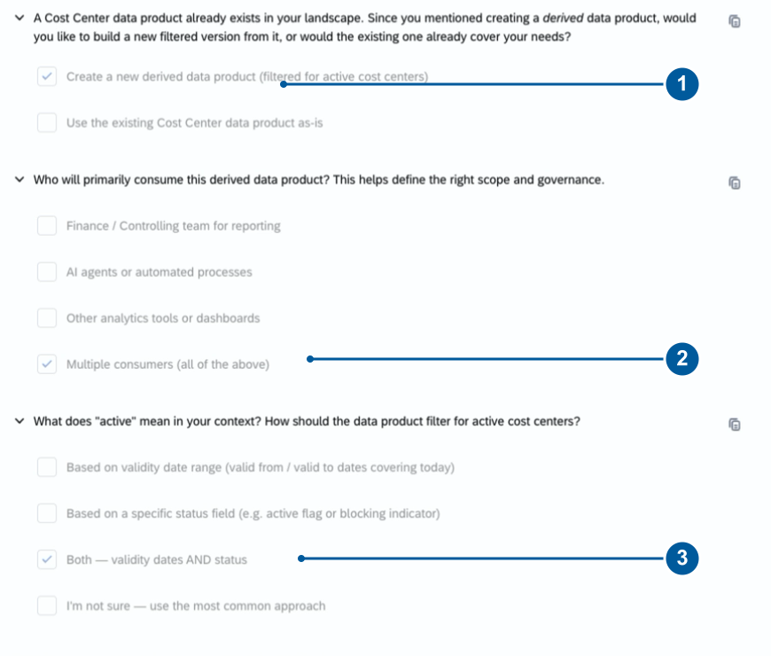
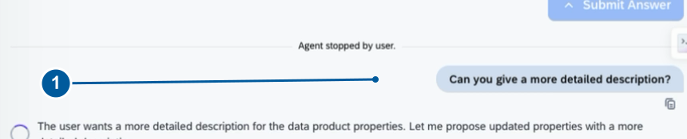
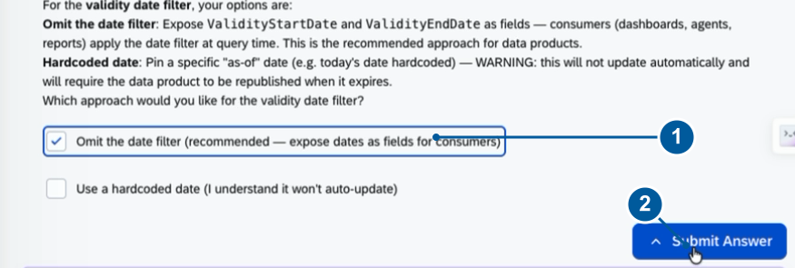
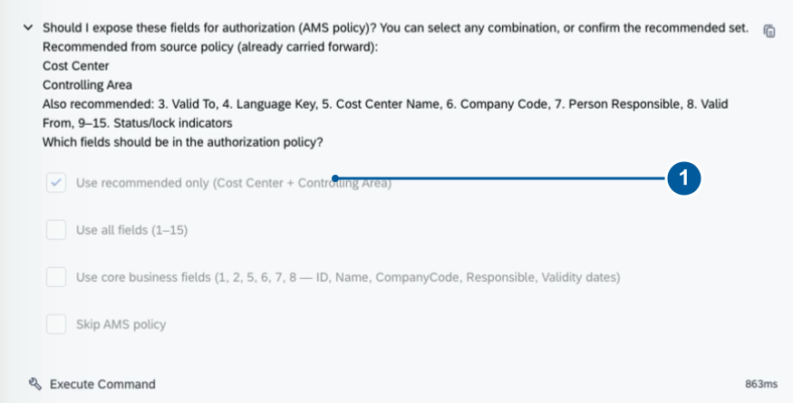
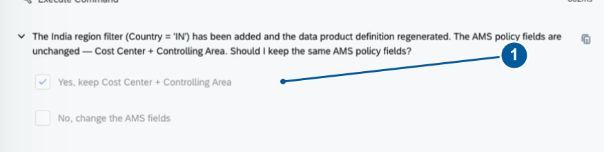
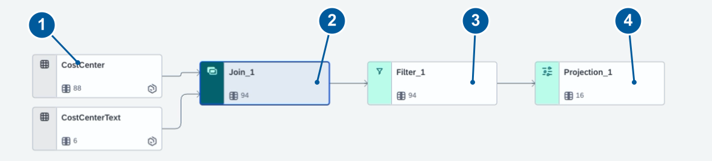

# Exercise 2 — Active Cost Centers for India

In this exercise, you will build a derived data product for non-blocked cost centers filtered to India. The agent will surface a date-handling constraint and ask how you want to resolve it, then you will refine the result for a specific geography. You guide Joule through intent, requirements, specification, generation and review.

**What you will build:** A data product exposing active, non-blocked cost centers for India, with validity dates available for consumers to apply their own as-of-date logic.

**Time:** ~50 minutes, including access and introduction

> **Before you begin:** Your solution name includes a participant ID provided by the session owner. Keep it ready.

Follow the numbered actions. Paste each prompt only at its stated step. For a structured question, choose the answer and select **Submit Answer**. Joule's wording can vary between runs; compare the meaning, not the exact words. If something fails or looks different from the screenshots, see [Troubleshooting](#troubleshooting) at the end of this exercise.

**Keep these distinctions clear:**
- *Non-blocked* does not mean *valid today*. The product exposes validity dates, and consumers apply the as-of-date condition they choose.
- Preview rows are simulated test data, not live customer data.
- This exercise ends at a reviewed definition. Deployment and live-data testing are separate activities.

---

## Before You Begin

### Check your access

1. Open the workshop Joule Studio URL supplied by the session owner and sign in with your assigned account.
2. Confirm that you can see **Solutions**, start a Data Product, and use the Joule conversation panel.
3. Keep your assigned participant ID ready. You will use it in the solution name.

The core build needs the **Cost Center** source. Joule searches for it during the exercise. Ask a workshop assistant if it is unavailable.

✓ **Checkpoint** — You are signed in and can begin a new solution. Resolve access issues before you continue.

### Know the workspace

| Area | Use |
|---|---|
| Joule conversation | Enter prompts, answer questions, and review proposals. |
| Solution Progress | Open intent, requirements, specification, and generated artifacts. |
| Objects and Transformations | Inspect source nodes, output columns, and transformation logic. |
| File tree | Find the generated definition, transformation, and descriptors. |

### Follow the room pace

| Segment | Suggested time | Stopping point |
|---|---|---|
| Access and introduction | 5 minutes | Ready to create |
| Intent and specification (Exercises 1 to 3) | 15 minutes | Build started |
| Generation and refinement (Exercises 4 to 6) | 20 minutes | India definition generated |
| Inspection (Exercise 7) | 10 minutes | Core checkpoint |

These timings are planning estimates. You do not need to write SQL or install any tooling; Joule performs the generation steps.

---

## Exercise 1 — Start the Core Data Product

**Goal:** Create a solution and submit the business request.

1. Select **+ New**, then **Data Product**. Keep **Solution** set to **New Solution**.
2. In the **Name** field, enter:

   ```
   DA161 <participant ID> Cost Center Analytics
   ```

   Replace `<participant ID>` with the identifier provided by the session owner.

3. In the **Intent Statement** field, paste the following exactly:

> **Paste this:**
> ```
> Create a derived data product for active cost centers with fields: cost center ID, name, company code, responsible person, validity dates, and status. start with intent-analysis
> ```

4. Leave **Quick Create** unchecked. Click **Create** once and wait for the workspace to open.
<br>

✓ **Checkpoint** — You should see: your named solution is open and the cost center request appears in the Joule conversation panel. Wait for source discovery — do not submit a second request.

---

## Exercise 2 — Confirm the Source and Business Goal

**Goal:** Define the source, the consumers, and the meaning of *active*.

1. Review the **Cost Center** source recommendation. The expected source is `sap.s4com:dataProduct:CostCenter:v1` (Active, version 1.1.2). If you see a different source or changed fields, ask a workshop assistant before continuing.
2. Choose **Create a new derived data product**, then **Multiple consumers (all of the above)**. Select **Submit Answer** after each choice.
<br>

3. When asked what **active** means, choose **Both — validity dates AND status**. This captures the full business meaning. Exercise 5 resolves how the date part is implemented.

4. When asked for a measurable business outcome, paste:

> **Paste this:**
> ```
> Reduce time spent on cost center lookups by 50%
> ```

5. Choose **No specific timeline** if asked for a baseline. If you are asked for a baseline value, say that none has been supplied. The 50% is an exercise target, not a measured result.

✓ **Checkpoint** — You should see: Joule records Cost Center as the source, multiple consumers, the active definition (dates and status), and the business target.

---

## Exercise 3 — Review the Intent and Build Plan

**Goal:** Approve the business scope before generation.

1. Review the **Intent Analysis Summary**. Check that it includes: the Cost Center source, the requested attributes (cost center ID, name, company code, responsible person, validity dates, status), multiple consumers, and the filtering intent. Confirm the summary so that Joule writes `intent.md`.
2. Select **Yes, proceed to PRD** (or **Generate Requirements** if that is the button shown).

3. Verify the generated requirements include:
   - **Fields:** cost center ID, name, company code, responsible person, validity start and end dates, and status
   - **Value:** simpler cost center lookup for finance, reporting, agents, and automated processes
   - **Scope:** derive and filter the available source — creating or editing cost centers and postings is outside scope

   Read the generated personas for their needs. Their illustrative names and demographics are not requirements.

4. Proceed to the specification when prompted. Review its checklist: metadata, source preparation, transformation, policy configuration, and preview.

5. When Joule indicates the specification is ready, paste:

> **Paste this:**
> ```
> execute specification/specification.md
> ```

✓ **Checkpoint** — You should see: Intent, Requirements, and Specifications available. Joule begins building `active-cost-centers-data-product` or the equivalent generated asset.

> **Pause and explain:** The intent states the business need. The requirements define the expected result. The specification translates that result into a build plan. Review each one before you advance.

> **If something is missing:** Ask Joule to inspect the current stage. Do not run the execution command before a specification exists, and do not accept an unrelated source to get around a gap.

---

## Exercise 4 — Review the Product Metadata

**Goal:** Make the product understandable before generation continues.

1. Wait for tooling preparation to complete. If something fails or looks different, see [Troubleshooting](#troubleshooting).

2. Review **Technical Name**, **Business Name**, the descriptions, and **Responsible**. Before approving the properties, ask Joule to improve the description. Paste:

> **Paste this:**
> ```
> Can you give a more detailed description?
> ```
<br>

3. Check that the revised description explains: purpose, fields, consumers, and the Cost Center source.

4. Verify the proposed properties:

   | Property | Expected value |
   |---|---|
   | Technical Name | `ActiveCostCenters` |
   | Business Name | `Active Cost Centers` |
   | Responsible | `customer:vendor:Customer` (default) |

   *Responsible* is product metadata. *Person Responsible* is a separate source-data attribute.

5. Select **Approve** when the revised properties are presented.

✓ **Checkpoint** — You should see: the message **"Properties approved"** and Joule preparing the schema and authorization information.

> **Review later:** After Exercise 5, the description must reflect that consumers apply the date filter.

---

## Exercise 5 — Date Handling and Authorization

**Goal:** Resolve the date-filter constraint explicitly, then review the authorization fields and the first result.

1. Read the filter confirmation. Joule reports that `current_date()` cannot be used inside the generated data product.

2. Select **Omit the date filter (recommended — expose dates as fields for consumers)**. Select **Submit Answer**.
<br>

3. Keep the status filtering — all seven blocking indicators must be false for a record to pass.

> **What this means:** The product returns non-blocked records and exposes `ValidityStartDate` and `ValidityEndDate`. A consumer must apply: `ValidityStartDate <= chosen as-of date <= ValidityEndDate`. A record can be non-blocked and still be outside its valid date range, so do not describe this definition as one that automatically returns only records valid today.

✓ **Checkpoint** — You should see: the consumer-side date approach recorded and both validity dates confirmed as available.

> **Discuss:** Which responsibility moved to the consumer? The as-of-date condition. The business need stays the same; where it is implemented has changed.

4. Choose **Use recommended only (Cost Center + Controlling Area)** at the authorization question. Select **Submit Answer**.
<br>

5. Wait for **"AMS policy injected"** and solution setup to complete. Read the generated summary and check these items:
   - The initial output is a dimension view, `ActiveCostCentersDimension` in this example.
   - `CostCenterText` provides the cost center name from the prepared Cost Center source schema.
   - Output attributes include ID, controlling area, name, company code, responsible person, language, dates, and blocking indicators.
   - All seven blocking filters are false, and the dates are exposed for consumer filtering.
   - The initial policy fields are Cost Center and Controlling Area.

✓ **Checkpoint** — You should see: an initial summary showing `ActiveCostCentersDimension`, with Cost Center and Controlling Area as the initial policy fields. Joule offers **Approve** or **Make a change**.

> **Note:** Policy generation configures the definition. Enforcement must be validated in a deployed runtime; this exercise does not test it.

---

## Exercise 6 — Refine for India

**Goal:** Filter by India and keep the non-blocked requirement.

1. Choose **Make a change**, then **Other (I'll describe)**. Submit the choices, then paste:

> **Paste this:**
> ```
> I would like to filter only active cost centers for India region and exclude blocked entries.
> ```

2. Wait for regeneration.

3. At the policy question, choose **Yes, keep Cost Center + Controlling Area**. Submit.
<br>

4. Check the updated summary against this list:

   - Country = IN
   - All seven blocking indicators = false
   - English names (Language = EN)
   - Country included in the output
   - Both `ValidityStartDate` and `ValidityEndDate` exposed

   The request's "India region" is implemented as a **Country** filter. Date validity still belongs to the consumer.

✓ **Checkpoint** — You should see: the India cost center definition generated with all of the above confirmed. You will inspect it in Exercise 7.

> **Discuss:** What changed and what stayed the same? Country limits the geography, the blocking filters remain, and the consumer still owns the as-of-date condition.

---

## Exercise 7 — Inspect and Complete the Core Build

**Goal:** Find the transformation and the artifacts you generated.

1. Under **Solution Artifacts**, select `active-cost-centers-data-product` (or the equivalent generated asset name).

2. In **Objects and Transformations**, inspect `CostCenter`, `CostCenterText`, and the output columns.

3. Select the transformation and choose **View Graphical Transformation** where available. Follow the inputs through join, filter, and projection.
<br>

> **Note:** The graphical viewer is read-only. To request edits, use the Joule conversation panel.

4. In the **File tree**, locate:
   - `ActiveCostCenters.dpd`
   - `transformation.cds`
   - `asset.yaml`
   - `solution.yaml`

   File names may vary with the generated identity.

✓ **Checkpoint** — You should see: the India-filtered definition, its source inputs, output fields, policy summary, and generated files all accessible. The core build is complete.

---

## Stopping Point

**Finishing the core build:** Read the updated summary. If everything looks correct, choose **Approve — looks good**. Keep your solution identifier for follow-up, and follow the session owner's closing instructions.

> **Do not click Deploy.** Deployment is not demonstrated in this session.

Your result in one sentence: *"Non-blocked India cost centers, with validity dates for consumer filtering and reviewed policy fields."*

---

**Continuing to the optional extension:** Keep the current review open and proceed to [Exercise 3 — Planned Budget Extension](../ex3/README.md). You will choose **Make another change** at the start of that exercise.

---

## Troubleshooting

Find your latest successful checkpoint. Read the current Joule question before you enter another prompt or start a duplicate build. An unresolved generation error is not a passed checkpoint.

| If you see... | What to do |
|---|---|
| Access or creation fails | Ask a workshop assistant to confirm the assigned URL, account, and permissions. |
| The source is missing or changed | Check the identifier and fields with the assistant. Do not substitute an unrelated source. |
| Joule is waiting | Scroll to the latest question. Choose the answer and select **Submit Answer**. |
| A tooling or generation error | Wait for explicit recovery. Ask for help if it repeats or stops. Do not run manual setup commands. |
| A different choice or question than in this guide | Match the business meaning. Ask for help when the source, filters, grouping, or policy would change. |
| The date filter cannot be generated | Use the reviewed consumer-side date option and keep both validity fields. |
| The viewer shows old output | Reselect the artifact after regeneration and confirm the latest properties. |
| You are behind the group | Tell the assistant your last checkpoint. Complete the core build first. |

If the sources, policy fields, or results are unclear, keep the review open and ask the assistant before you approve.

---

## Reference

### Prompts used in this exercise

Use these prompts at their corresponding steps. Do not paste the list as one request.

| Step | Prompt |
|---|---|
| Exercise 1 — initial intent | `Create a derived data product for active cost centers with fields: cost center ID, name, company code, responsible person, validity dates, and status. start with intent-analysis` |
| Exercise 2 — business outcome | `Reduce time spent on cost center lookups by 50%` |
| Exercise 3 — start generation | `execute specification/specification.md` |
| Exercise 4 — metadata refinement | `Can you give a more detailed description?` |
| Exercise 6 — India refinement | `I would like to filter only active cost centers for India region and exclude blocked entries.` |

### Choices to remember

Derived product → multiple consumers → dates AND status requested → consumer-side date filtering selected → Cost Center + Controlling Area policy → India refinement.

### Find your generated work

| Artifact | Purpose |
|---|---|
| `intent.md` and requirements | Business purpose, consumers, fields, and scope. |
| `specification/specification.md` | The build checklist. |
| `ActiveCostCenters.dpd` | Generated data product definition. |
| `transformation.cds` | Projection, filters, joins, and aggregation. |
| `asset.yaml` and `solution.yaml` | Asset and solution descriptors, including source references. |

**Key terms:** PRD means Product Requirements Document. AMS refers to the generated authorization policy configuration. A *dimension* describes cost centers. File names can vary with the generated identity.
