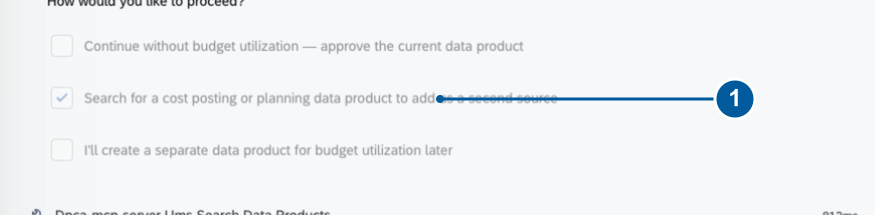
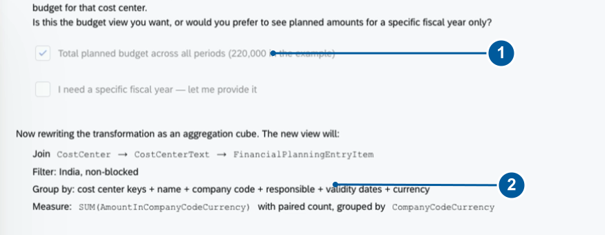
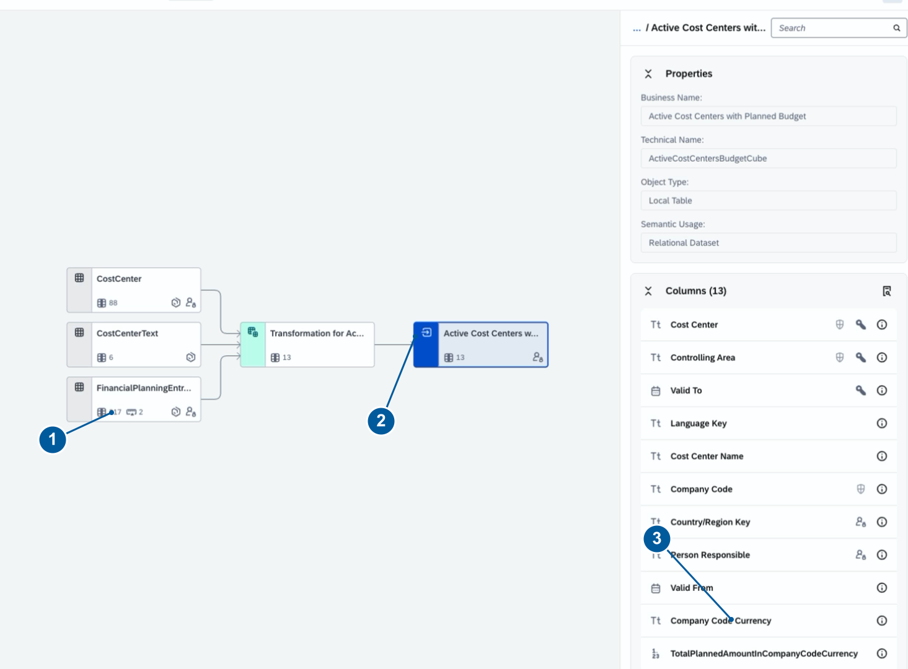
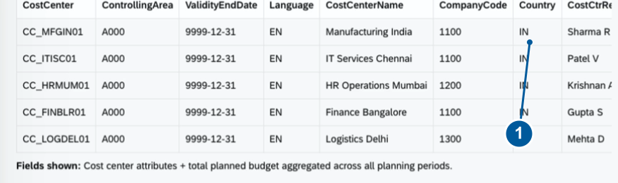

# Exercise 3 — Planned Budget Extension *(Optional)*

> **This exercise is optional.** Complete [Exercise 2](../ex2/README.md) through the core stopping point checkpoint before continuing here.

In this exercise, you will extend your India cost center data product with planned budget amounts from a second source. The agent will surface a data gap — no actual cost posting data is available — and ask you to decide how to proceed.

**What you will add:** Planned budget amounts per cost center, drawn from Financial Planning Entry Item data.

**Time:** ~20 minutes

---

## Exercise 8 — Discover the Budget Source Gap

1. At the review question in your existing solution, choose **Make another change**, then **Other (I'll describe)**. Submit the choices, then paste:

> **Paste this:**
> ```
> I would like to see budget utilization percentages.
> ```

2. Read the agent's response. Cost Center master data does not contain the actual and planned amounts needed to calculate utilization.

3. Choose **Search for a cost posting or planning data product to add as a second source**. Submit.
<br>

4. Review **Financial Planning Entry Item** (`sap.s4com:dataProduct:FinancialPlanningEntryItem:v1`). This source provides planned data by cost center, fiscal year, and GL account.

> **Note:** The agent finds no actual cost posting source. Planned data supports a planned amount result, but cannot supply a utilization percentage on its own.

✓ **Checkpoint** — You should see: Joule offering planned budget amounts as a supported alternative. You have not yet approved a utilization calculation.

5. Choose **Add Financial Planning Entry Item — expose planned budget amounts per cost center**. Submit.

6. Choose **Yes — restructure as an aggregation cube with planned amounts**. Submit.

> **What changes:** The output shifts from descriptive master data (a dimension) to grouped planned amounts (a cube). Joule joins planning data using Cost Center and Controlling Area and sums `AmountInCompanyCodeCurrency`.

7. When asked about fiscal-year scope, choose **Total planned budget across all periods**. Submit.
<br>

> **What this means:** Totals combine all available planning periods and categories, not a single fiscal year. Multiple validity periods or currencies can produce multiple rows for a cost center. Do not combine different currencies without an explicit conversion rule.

8. Wait for regeneration and policy updates. Ask for help if Joule reports an unresolved error before advancing.

✓ **Checkpoint** — You should see: the approved extension containing planned amounts with currency, with India and blocking filters retained.

---

## Exercise 9 — Inspect the Enriched Definition

1. Reselect the artifact after regeneration — the viewer may still show the old dimension.

2. Find **FinancialPlanningEntryItem** alongside **CostCenter** and **CostCenterText** in the transformation graph.

3. Locate these output columns:
   - `CompanyCodeCurrency`
   - `TotalPlannedAmountInCompanyCodeCurrency`
   - Record count fields

4. Confirm that **Country** and both **validity dates** remain in the output.
<br>

5. Read the current policy summary. After enrichment the policy fields should be: **Cost Center**, **Controlling Area**, and **Company Code**.

✓ **Checkpoint** — You should see: the final transformation graph, output columns, and policy summary all reflecting the added planning source. The demo output is named `Active Cost Centers with Planned Budget` with transformation `ActiveCostCentersBudgetCube`.

---

## Exercise 10 — Preview, Approve, and Explain Your Result

1. Choose **Yes, show me a preview**. Read the **SIMULATED/TEST** label — this is mock data, not live customer data.
<br>

2. Verify the following before approving:

   - [ ] Cost Center and Financial Planning Entry Item are the sources
   - [ ] India filter and all blocking filters are retained; both validity dates remain exposed
   - [ ] Planned amount and currency are present with the approved all-period scope
   - [ ] Policy fields and descriptions match the enriched definition
   - [ ] The preview is clearly identified as SIMULATED/TEST

   > If metadata still promises automatic "valid today" filtering or utilization percentages, request a correction before approving.

3. Choose **Approve — data product is ready**. Submit and wait for Joule's completion summary.

> **Do not click Deploy.** Deployment is not demonstrated in this session.

✓ **Checkpoint** — You should see: the generated definition approved and available for inspection.

---

## Summary

You have completed the full workshop. You built and extended a data product that:

- Filters active, non-blocked cost centers for India
- Exposes validity dates for consumer-side date filtering
- Includes planned budget amounts from a second source, totalled across all planning periods
- Applies a reviewed authorization policy (Cost Center, Controlling Area, Company Code)

**Your result in one sentence:** *"I created a definition for non-blocked India cost centers with planned amounts in company code currency. Consumers apply date validity. The totals span all planning periods and are not utilization percentages."*

> **Next steps:** Deployment and live-data testing are the next stage of the roadmap. Keep your solution identifier and follow the session owner's instructions for retention or cleanup.
